# Reinforcement learning for ASV path following

Reinforcement learning controllers steer the rudder of the KRISO Container
Ship (KCS) to follow a path, trained and evaluated against one shared 3-DOF
maneuvering model so that the comparison is between the algorithms rather than
between copies of the task.

This repository accompanies the paper *Influence of Rudder Action Resolution on
Autonomous Ship Path Following* (Alam and Bazilinskyy). The paper compares three
controllers that differ in rudder action resolution: DQN with 3 actions, DQN
with 5 actions, and PPO with a continuous rudder. A DDPG controller is also
included here but is not part of the paper.

| Controller | Rudder command | In the paper | Config | Released policy |
|---|---|---|---|---|
| DQN, 3 actions | −35°, 0°, +35° | yes | [`configs/dqn_3_action.yaml`](configs/dqn_3_action.yaml) | [`models/dqn_3_action/calm_water_v1`](models/dqn_3_action/calm_water_v1) |
| DQN, 5 actions | −35°, −20°, 0°, +20°, +35° | yes | [`configs/dqn_5_action.yaml`](configs/dqn_5_action.yaml) | [`models/dqn_5_action/calm_water_v1`](models/dqn_5_action/calm_water_v1) |
| PPO | continuous, ±35° | yes | [`configs/ppo.yaml`](configs/ppo.yaml) | [`models/ppo/calm_water_v1`](models/ppo/calm_water_v1) |
| DDPG | continuous, ±35° | no | [`configs/ddpg.yaml`](configs/ddpg.yaml) | [`models/ddpg/calm_water_v1`](models/ddpg/calm_water_v1) |

## Why

Most marine accidents are attributable to human decision error, so automating
the path-following action of a ship is worth doing well. A 3-DOF MMG model
describes the ship's motion; the KCS hull is used because it is a benchmark
with published hydrodynamic coefficients. An agent is trained to interact with
that numerical model to achieve waypoint tracking, and the resulting controller
is then evaluated in wind and waves it never saw during training.

## Quick start

The project is managed with [uv](https://docs.astral.sh/uv/).

```bash
uv sync                          # create the environment from uv.lock

uv run scripts/analyze.py        # run the controllers in `config` and compare them
uv run scripts/train.py configs/ddpg.yaml --run-name my_run
uv run scripts/evaluate.py models/ddpg/calm_water_v1
```

`uv sync` installs the exact pinned set from `uv.lock`; `uv run` executes inside
that environment without activating anything. To add a package, use
`uv add <package>` rather than editing `pyproject.toml` by hand.

<details>
<summary>Without uv</summary>

```bash
python -m venv .venv && source .venv/bin/activate
pip install -r requirements.txt
python scripts/analyze.py
```

`requirements.txt` is a convenience mirror of the dependencies; `pyproject.toml`
is the source of truth.
</details>

### With Docker

The image pins the versions the released policies were trained with.

```bash
./docker/build.sh
./docker/run.sh                                          # interactive shell
./docker/run.sh python scripts/train.py configs/ppo.yaml # or run directly
```

The repository is bind-mounted into the container, so edits on the host take
effect immediately. GPUs are requested only when the host exposes them, and
figures are written to disk rather than displayed, so no X11 forwarding is
needed.

## The comparison

`scripts/analyze.py` is the headline experiment: it loads the trained policy of
every controller listed under `agents` in the [`config`](config) file (by
default the paper's three: DQN 3, DQN 5, and PPO), runs each one over the same
reference paths under the same conditions, and writes the comparison figures.
Edit that list to change which controllers take part — `--model NAME=PATH`
overrides it for a single run.

Every controller is evaluated with the same waypoint acceptance radius of
0.5 ship lengths, as in the paper. The controllers were trained with different
radii (DQN 5 with 1.5), so evaluating each at its own value would give them
different tasks. Pass `--arrival-radius trained` to use the trained values
instead.

```bash
uv run scripts/analyze.py                                       # calm water
uv run scripts/analyze.py --wind-speed 6 --wind-dir 90          # in wind
uv run scripts/analyze.py --trajectory star --trajectory spiral # chosen paths
uv run scripts/analyze.py --arrival-radius trained              # trained radii
```

Calm water results of the paper (Table II and Fig. 1) over its nine
manoeuvres. Every figure below is clickable and opens an interactive version.
Every other figure of the study is under [All figures](#all-figures).

[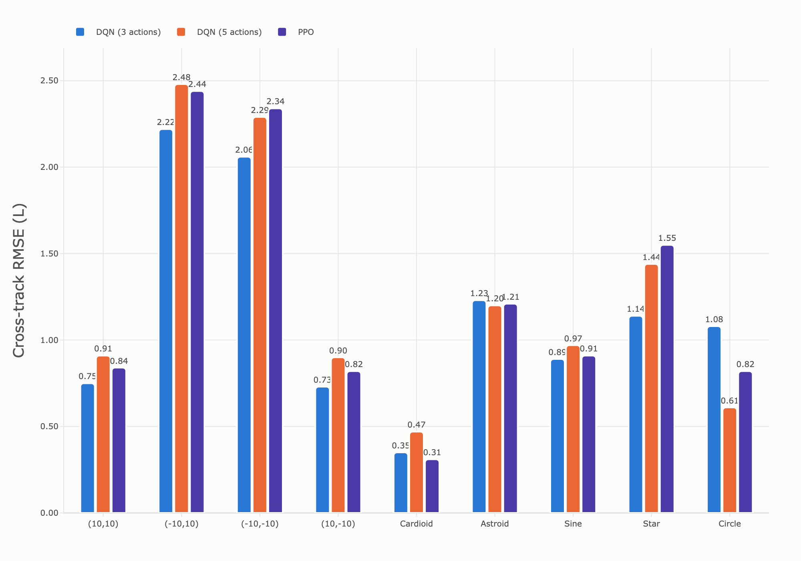](https://htmlpreview.github.io/?https://github.com/Shaadalam9/shipRL-actionresolution/blob/main/docs/figures/calm_summary_rmse.html)

*Fig. 1 of the paper, left: cross-track RMSE in ship lengths (L) for each
controller on the nine calm water manoeuvres: four single-destination paths
named by their goal (x, y) in L, then the cardioid, astroid, sine, star, and
circle. Lower is better.*

[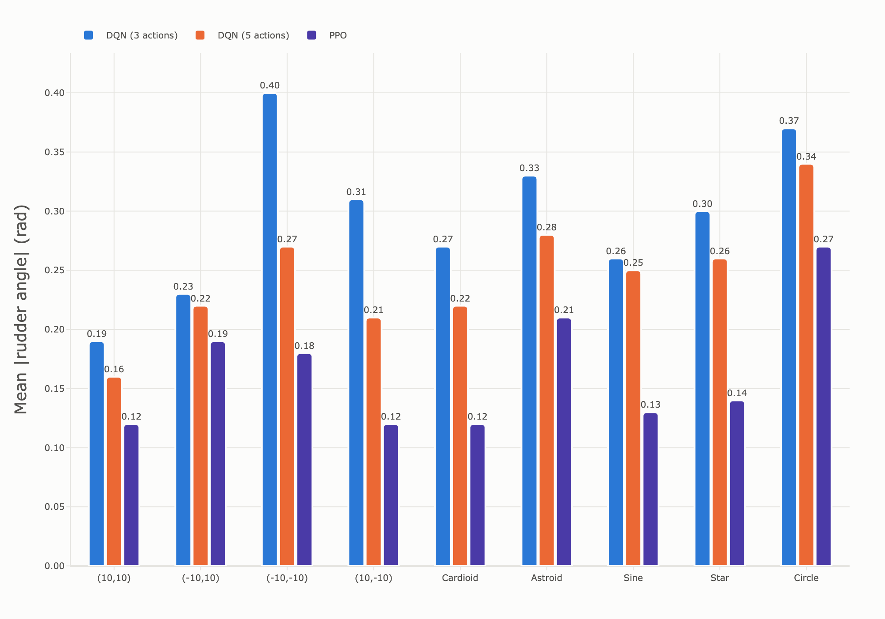](https://htmlpreview.github.io/?https://github.com/Shaadalam9/shipRL-actionresolution/blob/main/docs/figures/calm_summary_rudder.html)

*Fig. 1 of the paper, right: mean absolute realised rudder angle in radians on
the same manoeuvres, a measure of average steering demand. Lower is better. PPO
uses the least rudder on every manoeuvre.*

DQN 3 has the lowest mean cross-track RMSE in calm water (1.16 L against 1.25 L
for both others), while PPO uses the least rudder on every manoeuvre (mean
0.16 rad against 0.30 and 0.25). Finer rudder resolution helps most where the
path needs a sustained turn: on the circle, DQN 5 cuts the RMSE of DQN 3 from
1.08 L to 0.61 L. Under wind and waves PPO has the lowest mean RMSE (0.73 L) and
again the least rudder in every case.

[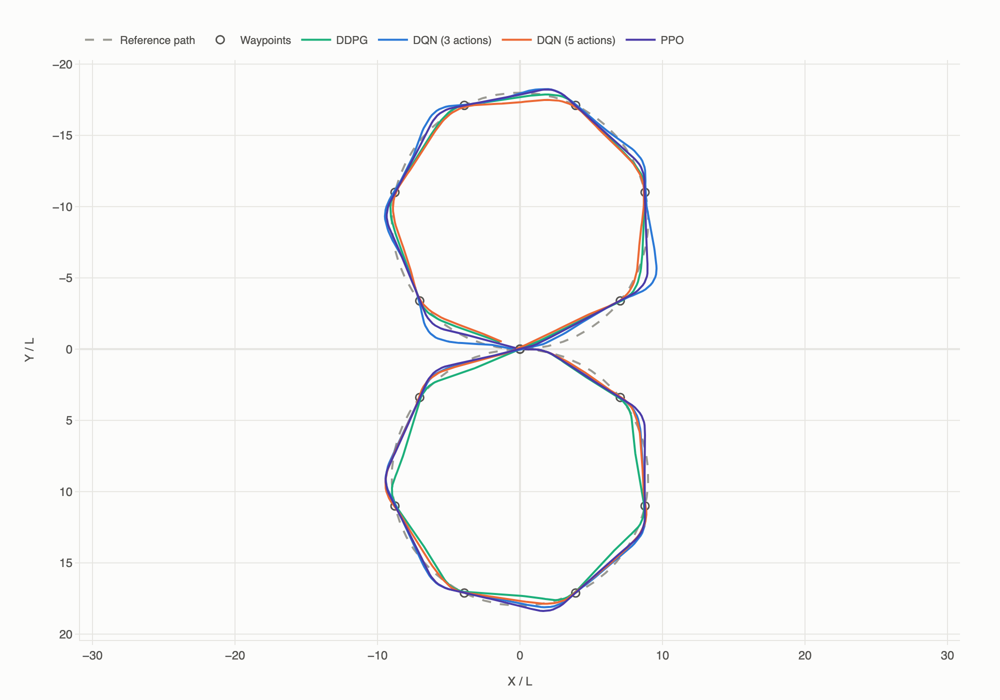](https://htmlpreview.github.io/?https://github.com/Shaadalam9/shipRL-actionresolution/blob/main/docs/figures/track_figure_eight.html)

*Not in the paper: tracks of the three controllers on the figure-of-eight in
calm water, produced by `analyze.py` from the released policies at the 0.5 L
arrival radius. The dashed line is the reference path and the circles are its
waypoints.*

### Model-scale experiments

The paper also tests the three policies on a 1:75.5 scale KCS model on a lake,
following a square path of about 40 m by 40 m (Fig. 2 and Table V of the paper).
Position comes from RTK GPS fused with an IMU, the propeller turns at a constant
speed, and the policy commands only the rudder.

| DQN, 3 actions | DQN, 5 actions | PPO |
|---|---|---|
| <a href="https://htmlpreview.github.io/?https://github.com/Shaadalam9/shipRL-actionresolution/blob/main/docs/figures/experiment_square_dqn_3.html">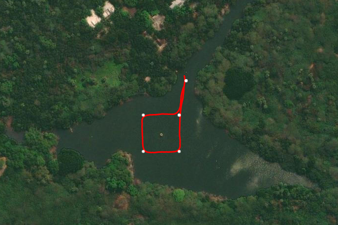</a> | <a href="https://htmlpreview.github.io/?https://github.com/Shaadalam9/shipRL-actionresolution/blob/main/docs/figures/experiment_square_dqn_5.html">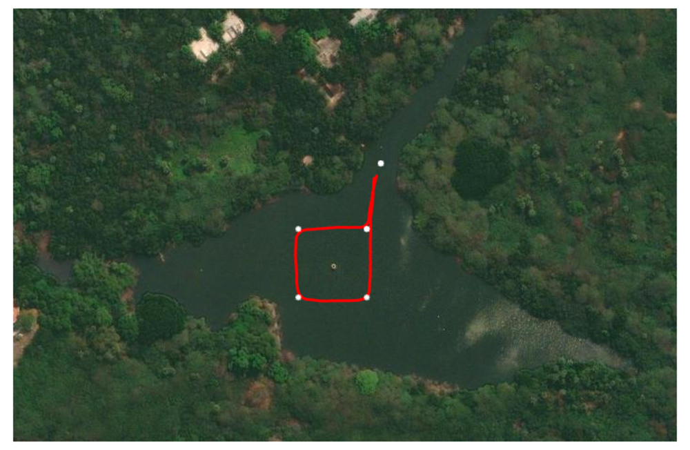</a> | <a href="https://htmlpreview.github.io/?https://github.com/Shaadalam9/shipRL-actionresolution/blob/main/docs/figures/experiment_square_ppo.html">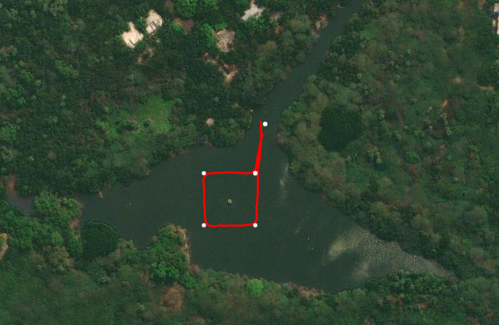</a> |

*Fig. 2 of the paper: measured tracks of the model-scale ship on the square
path, over aerial imagery of the test lake. White markers are the waypoints and
the red line is the measured trajectory. The experimental cross-track RMSE is
0.83 L for DQN 3, 0.86 L for DQN 5, and 0.79 L for PPO, an increase over
simulation of 29.7%, 38.1%, and 22.6%. The interactive versions are zoomable
images.*

Each run writes, per reference path, a track plot, a cross-track error series,
and a rudder angle series, plus three summary figures and a `results.json`.
Output goes to `analysis/`, which is not committed — regenerate it with the
command above. Add `--embed-plotlyjs` to make the HTML figures self-contained
(a few MB each), which the htmlpreview links in this README need.

## Reproducing the paper

The released policies are the evaluated checkpoints of the paper. The default
`analyze.py` run uses the paper's controllers, its 0.5 L arrival radius, and the
calm water paths of Table II that this code can build:

```bash
uv run scripts/analyze.py
```

The four single-destination rows of Table II (`quadrant_1` to `quadrant_4`)
are reproduced exactly. The cardioid, astroid, sine, and star rows, the
tightening spiral, and the wind and wave cases are not yet reproduced by the
current path definitions, and the circle and the model-scale square path are
not yet defined here.

The eight wind and wave cases of Table III map to these flags (directions in
degrees, wind speed relative to ship speed):

| Case | Command |
|---|---|
| I | `--trajectory figure_eight --wind-speed 6 --wind-dir 90 --wave-height 3 --wave-period 10 --wave-dir 45` |
| II | `--trajectory figure_eight --wind-speed 6 --wind-dir -90 --wave-height 3 --wave-period 10 --wave-dir -90` |
| III | `--trajectory cardioid --wind-speed 3 --wind-dir 0 --wave-height 2 --wave-period 15 --wave-dir 0` |
| IV | `--trajectory cardioid --wind-speed 5 --wind-dir 45 --wave-height 2 --wave-period 15 --wave-dir 0` |
| V | `--trajectory sine_wave --wind-speed 6 --wind-dir 180 --wave-height 3 --wave-period 8 --wave-dir 180` |
| VI | `--trajectory sine_wave --wind-speed 3 --wind-dir 90 --wave-height 3 --wave-period 8 --wave-dir 90` |
| VII | `--trajectory astroid --wind-speed 4 --wind-dir 135 --wave-height 2 --wave-period 10 --wave-dir 135` |
| VIII | `--trajectory astroid --wind-speed 4 --wind-dir 45 --wave-height 3 --wave-period 20 --wave-dir -45` |

Fig. 1 of the paper and the two calm water figures above are drawn from the
values of Table II by `uv run scripts/paper_figures.py`, which writes
`paper/plots/calm_summary_*.pdf` and `docs/figures/calm_summary_*.{png,html}`.
The same script writes the zoomable HTML beside each Fig. 2 image in
`docs/figures/experiment_square_*.png`.

## All figures

Every figure of the study is collected here by topic, beyond Figs. 1 and 2 of
the paper shown above. Click any figure to open a zoomable version (scroll to
zoom, drag to pan, double-click to reset). The images are in
[`docs/figures/gallery/`](docs/figures/gallery), each with its viewer page
beside it, written by `uv run scripts/paper_figures.py`.

Conventions that hold for all trajectory plots: positions are in ship lengths
(X/L, Y/L) and the Y axis points down, as in the coordinate system below. Many
legends also list DDPG, which was part of the original study but not of the
paper. Unless a caption says otherwise, a figure is not reproduced in the
paper.

### Ship model and task

The coordinate system, the model ship, the reward, and the termination rule.

|  |  |  |
|---|---|---|
| <a href="https://htmlpreview.github.io/?https://github.com/Shaadalam9/shipRL-actionresolution/blob/main/docs/figures/gallery/model/coordinate_system.html">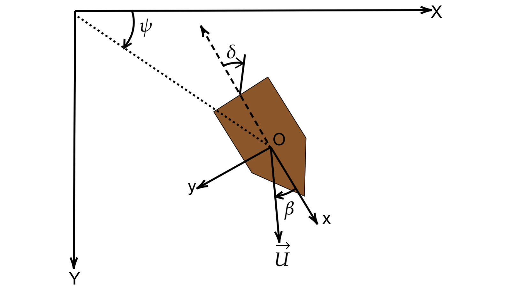</a><br>Coordinate system | <a href="https://htmlpreview.github.io/?https://github.com/Shaadalam9/shipRL-actionresolution/blob/main/docs/figures/gallery/model/kcs_hull.html">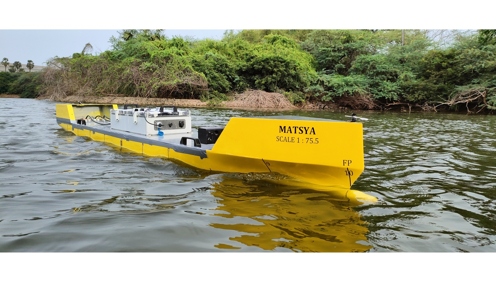</a><br>Model ship | <a href="https://htmlpreview.github.io/?https://github.com/Shaadalam9/shipRL-actionresolution/blob/main/docs/figures/gallery/model/kcs_hull_1.html"></a><br>Model ship, blurred |
| <a href="https://htmlpreview.github.io/?https://github.com/Shaadalam9/shipRL-actionresolution/blob/main/docs/figures/gallery/model/reward.html">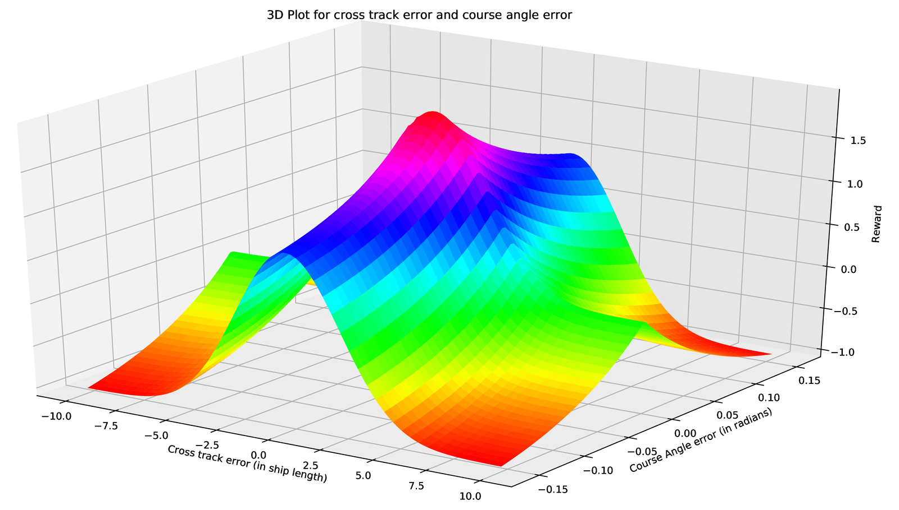</a><br>Reward surface | <a href="https://htmlpreview.github.io/?https://github.com/Shaadalam9/shipRL-actionresolution/blob/main/docs/figures/gallery/model/rewards_3d.html">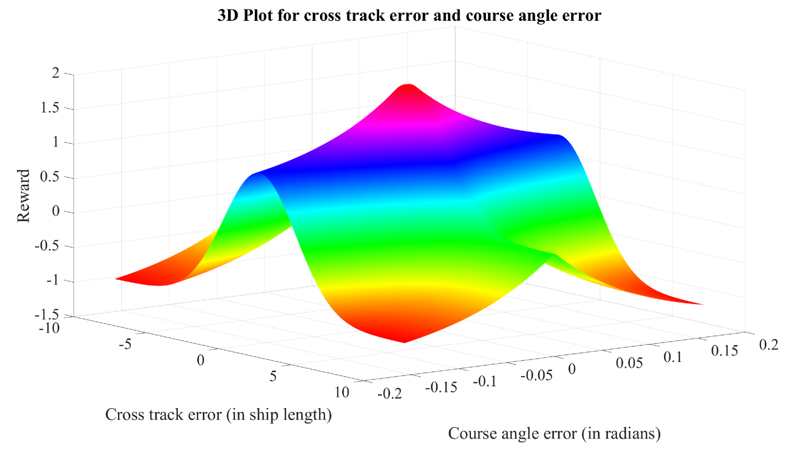</a><br>Reward surface, second view | <a href="https://htmlpreview.github.io/?https://github.com/Shaadalam9/shipRL-actionresolution/blob/main/docs/figures/gallery/model/term_cond.html">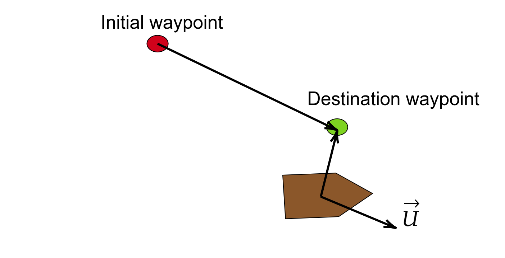</a><br>Termination condition |

- **Coordinate system.** Earth-fixed X–Y frame and body-fixed x–y frame at the ship's centre O, with heading ψ, rudder angle δ, drift angle β, and velocity U.
- **Model ship.** The 1:75.5 scale KCS model used for the experiments of Fig. 2 and Table V of the paper.
- **Model ship, blurred.** The same photograph blurred, for use as a background.
- **Reward surface.** Per-step reward, without the distance term, against cross-track error (ship lengths) and course angle error (rad). It peaks at 2 when both errors are zero.
- **Reward surface, second view.** The same reward over ±10 L of cross-track error and ±0.2 rad of course angle error.
- **Termination condition.** An episode ends when the ship has passed the destination waypoint and its velocity U points away from it.

### Training curves

Training loss and episode return of each controller in calm water. The DQN and
DDPG curves run over 10 000 episodes; PPO runs over 100 iterations of 50
episodes. The released checkpoints are episode 7000 (DQN 3), episode 10 000
(DQN 5), and iteration 60 (PPO).

| Loss | Return |
|---|---|
| <a href="https://htmlpreview.github.io/?https://github.com/Shaadalam9/shipRL-actionresolution/blob/main/docs/figures/gallery/training/dqn_3_loss.html">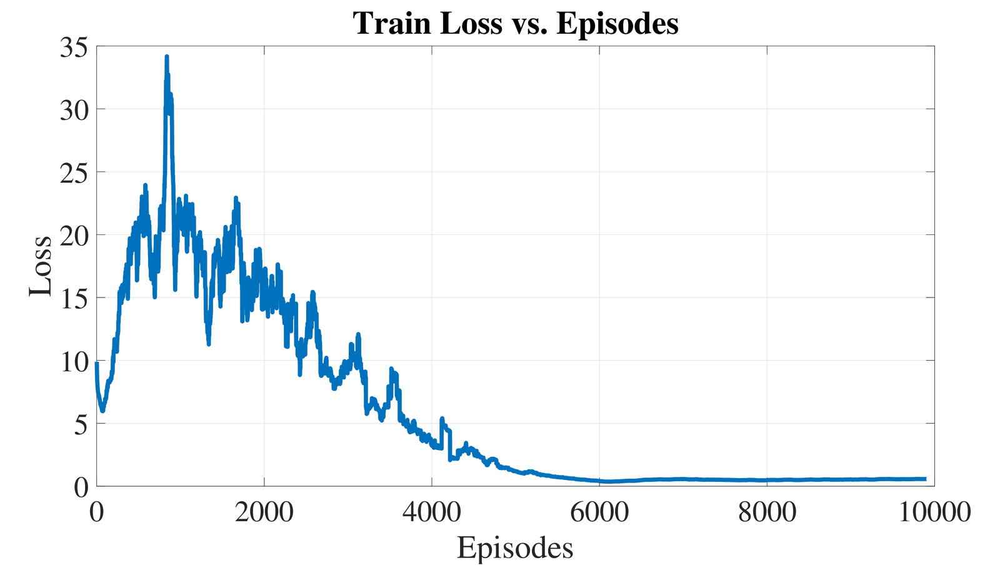</a><br>DQN, 3 actions, loss | <a href="https://htmlpreview.github.io/?https://github.com/Shaadalam9/shipRL-actionresolution/blob/main/docs/figures/gallery/training/dqn_3_returns.html">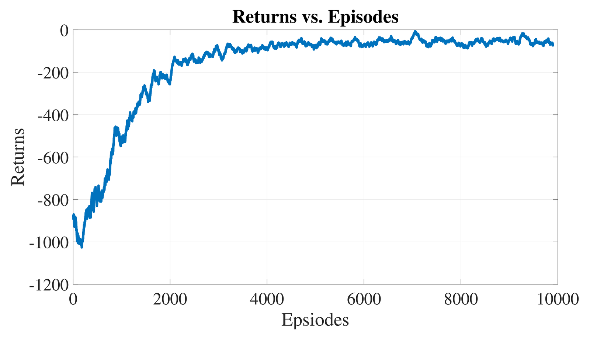</a><br>DQN, 3 actions, return |
| <a href="https://htmlpreview.github.io/?https://github.com/Shaadalam9/shipRL-actionresolution/blob/main/docs/figures/gallery/training/dqn_5_loss.html">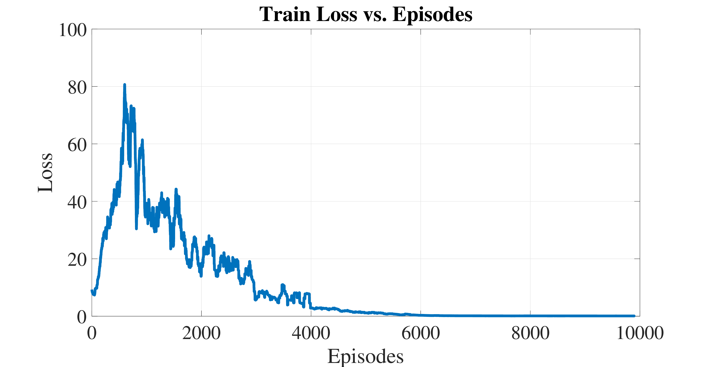</a><br>DQN, 5 actions, loss | <a href="https://htmlpreview.github.io/?https://github.com/Shaadalam9/shipRL-actionresolution/blob/main/docs/figures/gallery/training/dqn_5_returns.html">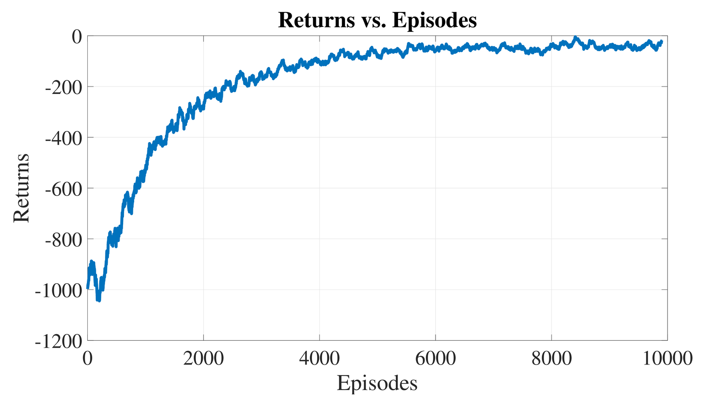</a><br>DQN, 5 actions, return |
| <a href="https://htmlpreview.github.io/?https://github.com/Shaadalam9/shipRL-actionresolution/blob/main/docs/figures/gallery/training/ppo_loss.html">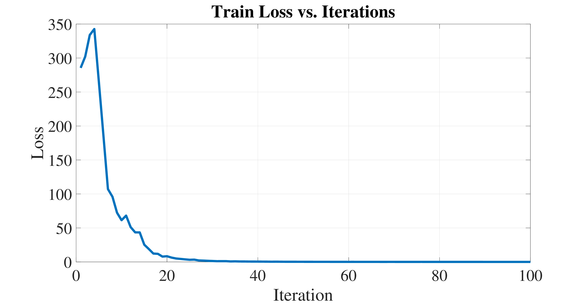</a><br>PPO, loss | <a href="https://htmlpreview.github.io/?https://github.com/Shaadalam9/shipRL-actionresolution/blob/main/docs/figures/gallery/training/ppo_returns.html">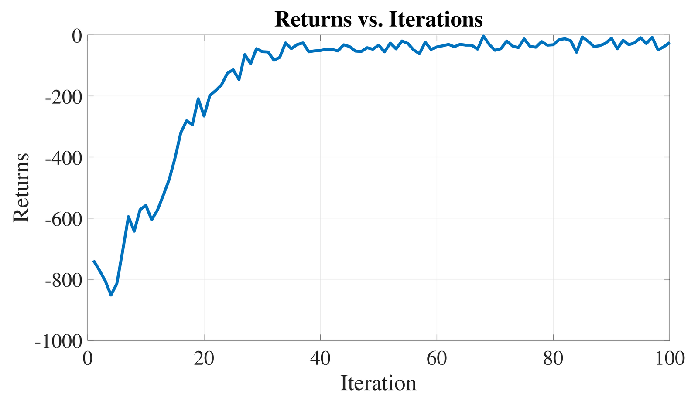</a><br>PPO, return |
| <a href="https://htmlpreview.github.io/?https://github.com/Shaadalam9/shipRL-actionresolution/blob/main/docs/figures/gallery/training/ddpg_loss.html">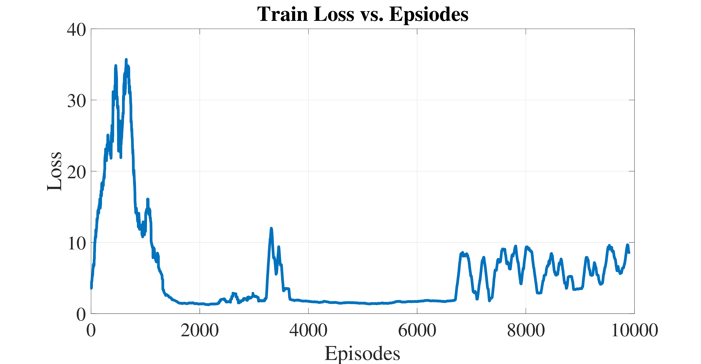</a><br>DDPG, loss | <a href="https://htmlpreview.github.io/?https://github.com/Shaadalam9/shipRL-actionresolution/blob/main/docs/figures/gallery/training/ddpg_returns.html">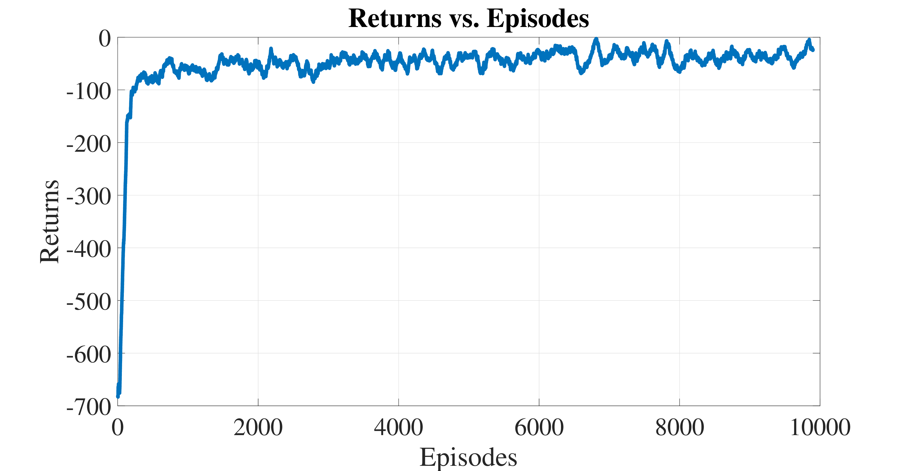</a><br>DDPG, return |

- **DQN, 3 actions, loss.** Loss peaks near 35 early on and settles below 1 after about 6000 episodes.
- **DQN, 3 actions, return.** Return rises from about −1000 and levels off between about −100 and −50 after 3000 episodes.
- **DQN, 5 actions, loss.** Loss peaks near 80 early on and falls to about zero after about 6000 episodes.
- **DQN, 5 actions, return.** Return rises from about −1000 and levels off near −50 after about 6000 episodes.
- **PPO, loss.** Loss falls from about 340 to near zero within 30 iterations.
- **PPO, return.** Return rises from about −850 and levels off near −50 after 35 iterations.
- **DDPG, loss.** Loss peaks near 35, drops below 2 by episode 2000, and rises again after episode 6500.
- **DDPG, return.** Return rises from about −700 to about −100 within 500 episodes, then stays near −50.

### Statistical analysis of training

Histograms of the average training loss and of the average return of each
controller at several points in training (the number in each caption). The
vertical axis counts how often each value occurs, and one bar per histogram is
highlighted in red in the original analysis. The PPO titles say episodes, but
PPO trained for 100 iterations, so its numbers are most likely iterations.


**DQN, 3 actions**

| Episode 2000 | Episode 4000 | Episode 7000 | Episode 10000 |
|---|---|---|---|
| <a href="https://htmlpreview.github.io/?https://github.com/Shaadalam9/shipRL-actionresolution/blob/main/docs/figures/gallery/statistics/dqn_3_loss_02000.html">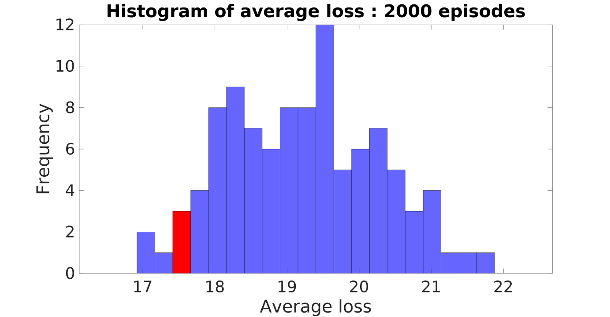</a><br>Loss | <a href="https://htmlpreview.github.io/?https://github.com/Shaadalam9/shipRL-actionresolution/blob/main/docs/figures/gallery/statistics/dqn_3_loss_04000.html">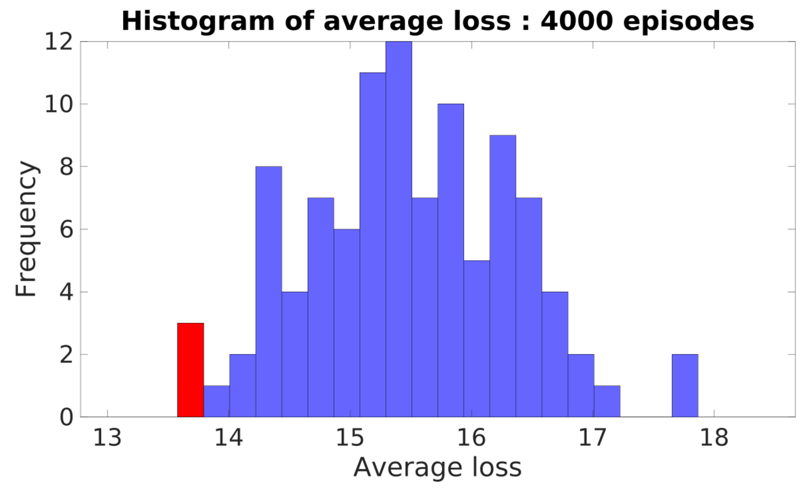</a><br>Loss | <a href="https://htmlpreview.github.io/?https://github.com/Shaadalam9/shipRL-actionresolution/blob/main/docs/figures/gallery/statistics/dqn_3_loss_07000.html">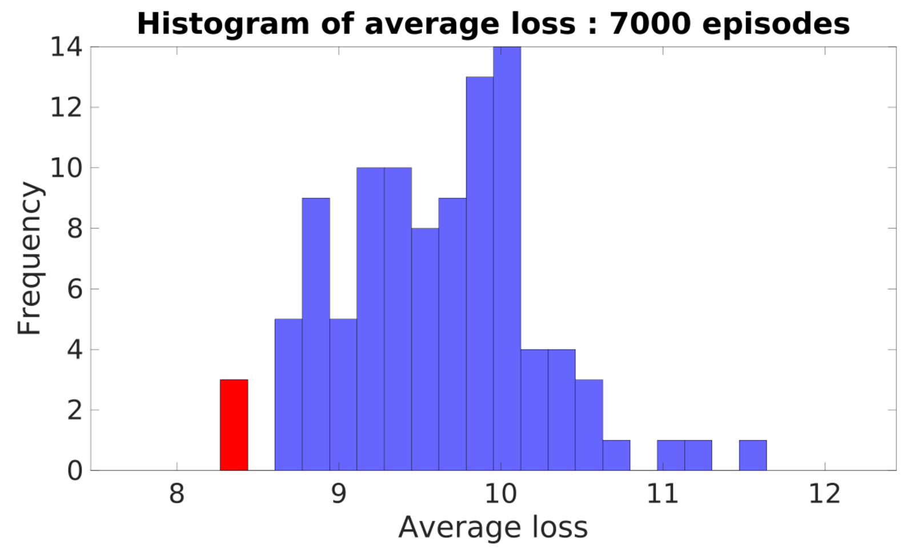</a><br>Loss | <a href="https://htmlpreview.github.io/?https://github.com/Shaadalam9/shipRL-actionresolution/blob/main/docs/figures/gallery/statistics/dqn_3_loss_10000.html">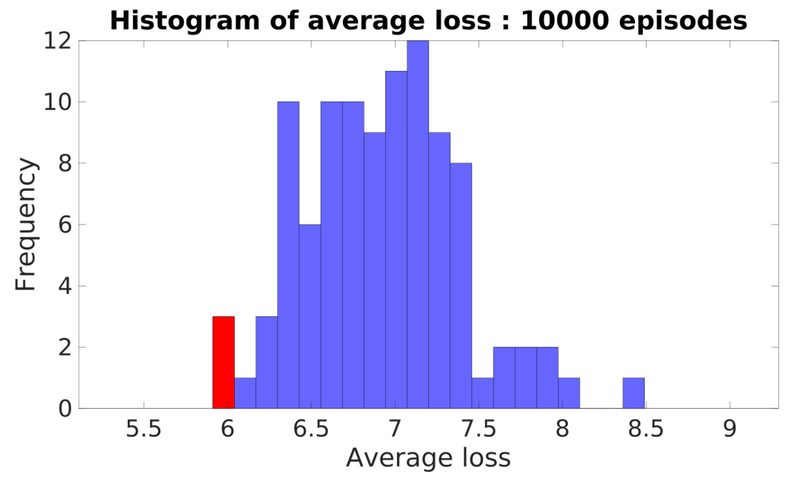</a><br>Loss |
| <a href="https://htmlpreview.github.io/?https://github.com/Shaadalam9/shipRL-actionresolution/blob/main/docs/figures/gallery/statistics/dqn_3_returns_02000.html">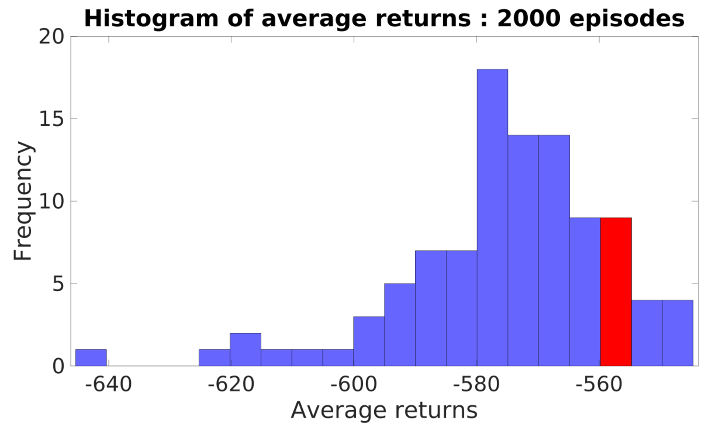</a><br>Return | <a href="https://htmlpreview.github.io/?https://github.com/Shaadalam9/shipRL-actionresolution/blob/main/docs/figures/gallery/statistics/dqn_3_returns_04000.html">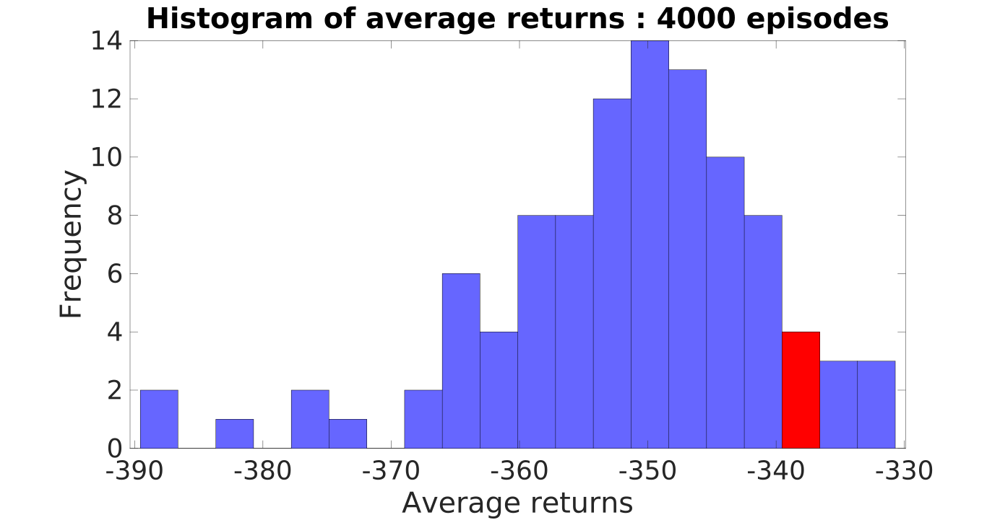</a><br>Return | <a href="https://htmlpreview.github.io/?https://github.com/Shaadalam9/shipRL-actionresolution/blob/main/docs/figures/gallery/statistics/dqn_3_returns_07000.html">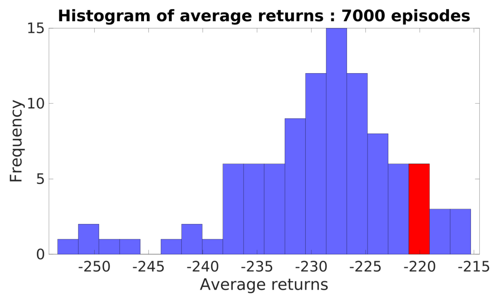</a><br>Return | <a href="https://htmlpreview.github.io/?https://github.com/Shaadalam9/shipRL-actionresolution/blob/main/docs/figures/gallery/statistics/dqn_3_returns_10000.html">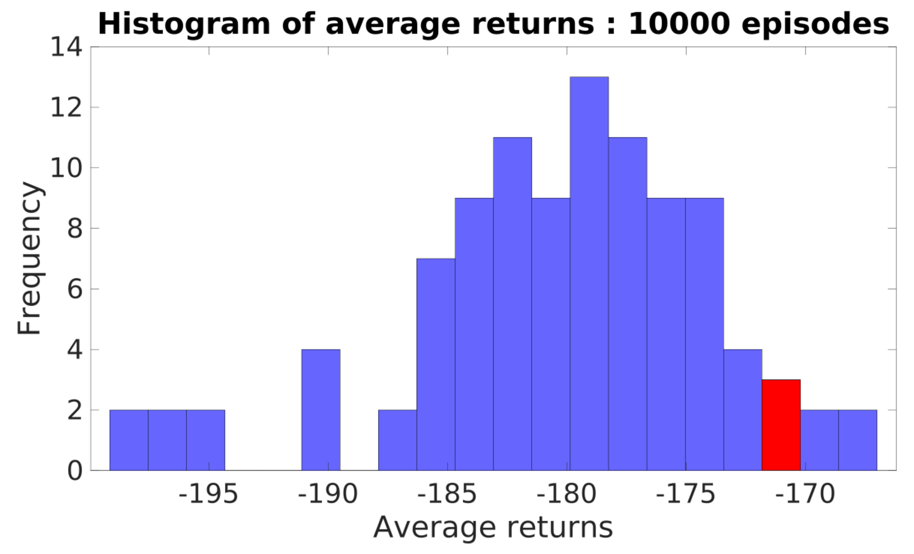</a><br>Return |

**DQN, 5 actions**

| Episode 2000 | Episode 4000 | Episode 7000 | Episode 10000 |
|---|---|---|---|
| <a href="https://htmlpreview.github.io/?https://github.com/Shaadalam9/shipRL-actionresolution/blob/main/docs/figures/gallery/statistics/dqn_5_loss_02000.html">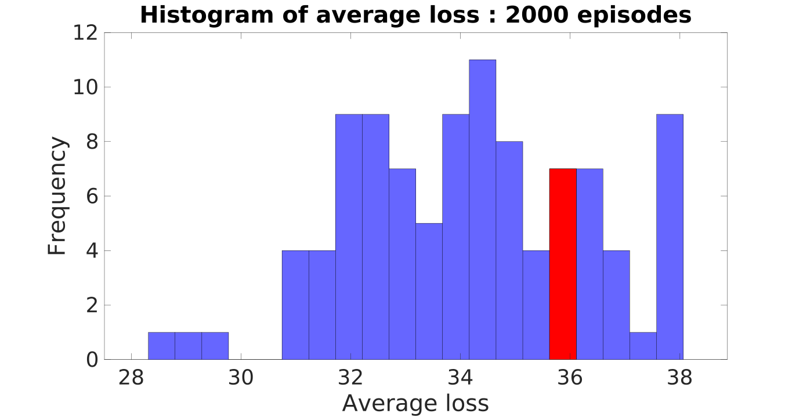</a><br>Loss | <a href="https://htmlpreview.github.io/?https://github.com/Shaadalam9/shipRL-actionresolution/blob/main/docs/figures/gallery/statistics/dqn_5_loss_04000.html">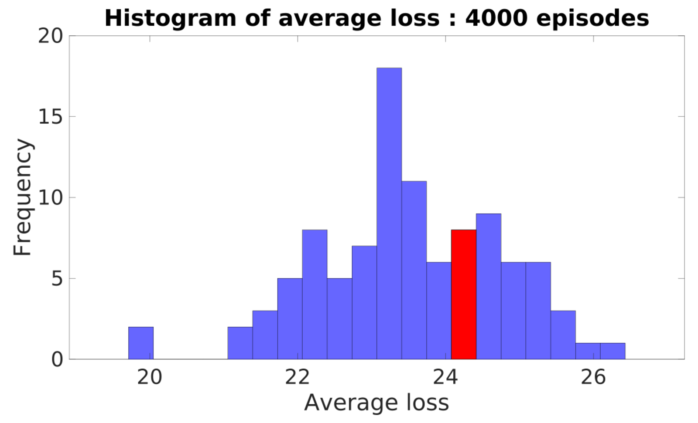</a><br>Loss | <a href="https://htmlpreview.github.io/?https://github.com/Shaadalam9/shipRL-actionresolution/blob/main/docs/figures/gallery/statistics/dqn_5_loss_07000.html">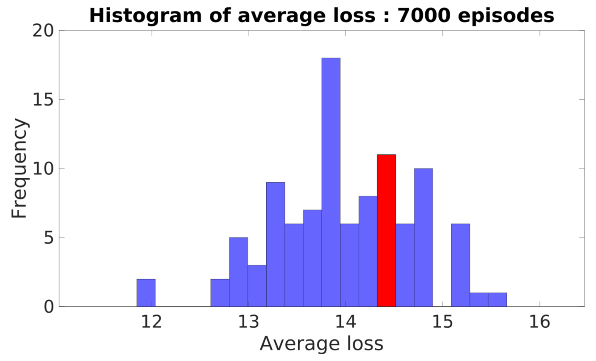</a><br>Loss | <a href="https://htmlpreview.github.io/?https://github.com/Shaadalam9/shipRL-actionresolution/blob/main/docs/figures/gallery/statistics/dqn_5_loss_10000.html">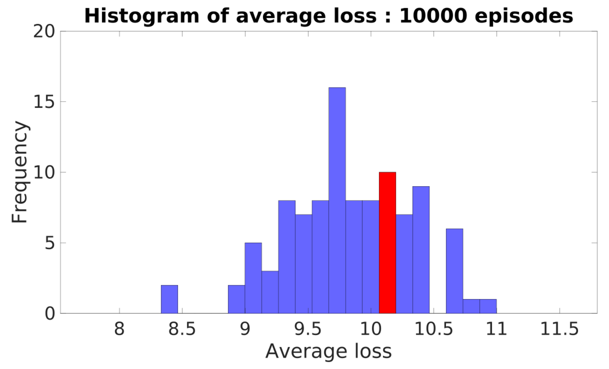</a><br>Loss |
| <a href="https://htmlpreview.github.io/?https://github.com/Shaadalam9/shipRL-actionresolution/blob/main/docs/figures/gallery/statistics/dqn_5_returns_02000.html">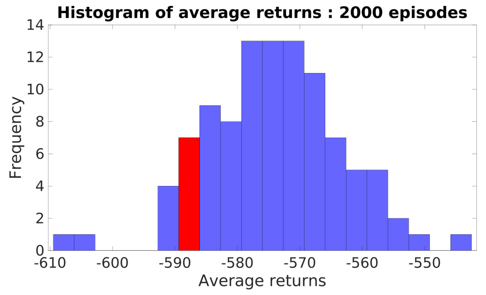</a><br>Return | <a href="https://htmlpreview.github.io/?https://github.com/Shaadalam9/shipRL-actionresolution/blob/main/docs/figures/gallery/statistics/dqn_5_returns_04000.html">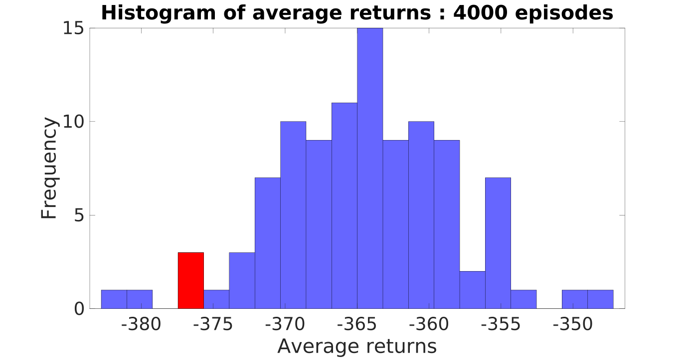</a><br>Return | <a href="https://htmlpreview.github.io/?https://github.com/Shaadalam9/shipRL-actionresolution/blob/main/docs/figures/gallery/statistics/dqn_5_returns_07000.html">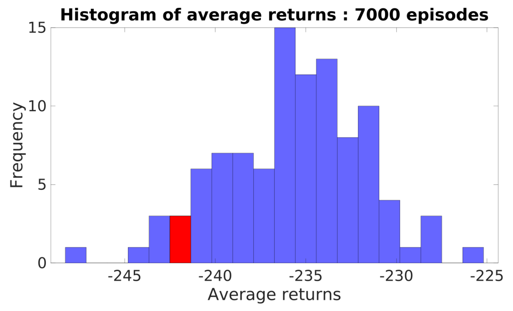</a><br>Return | <a href="https://htmlpreview.github.io/?https://github.com/Shaadalam9/shipRL-actionresolution/blob/main/docs/figures/gallery/statistics/dqn_5_returns_10000.html">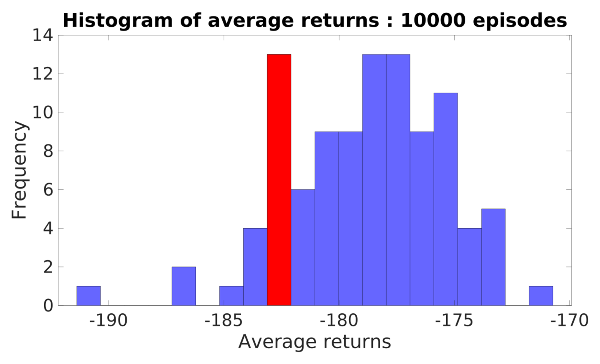</a><br>Return |

**PPO**

| Iteration 20 | Iteration 40 | Iteration 60 | Iteration 100 |
|---|---|---|---|
| <a href="https://htmlpreview.github.io/?https://github.com/Shaadalam9/shipRL-actionresolution/blob/main/docs/figures/gallery/statistics/ppo_loss_00020.html">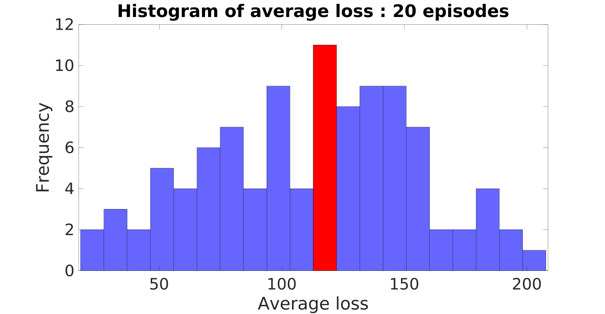</a><br>Loss | <a href="https://htmlpreview.github.io/?https://github.com/Shaadalam9/shipRL-actionresolution/blob/main/docs/figures/gallery/statistics/ppo_loss_00040.html">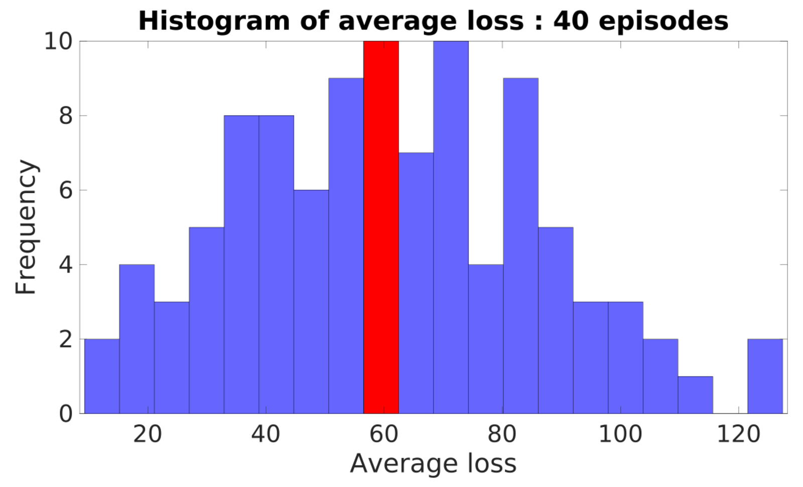</a><br>Loss | <a href="https://htmlpreview.github.io/?https://github.com/Shaadalam9/shipRL-actionresolution/blob/main/docs/figures/gallery/statistics/ppo_loss_00060.html">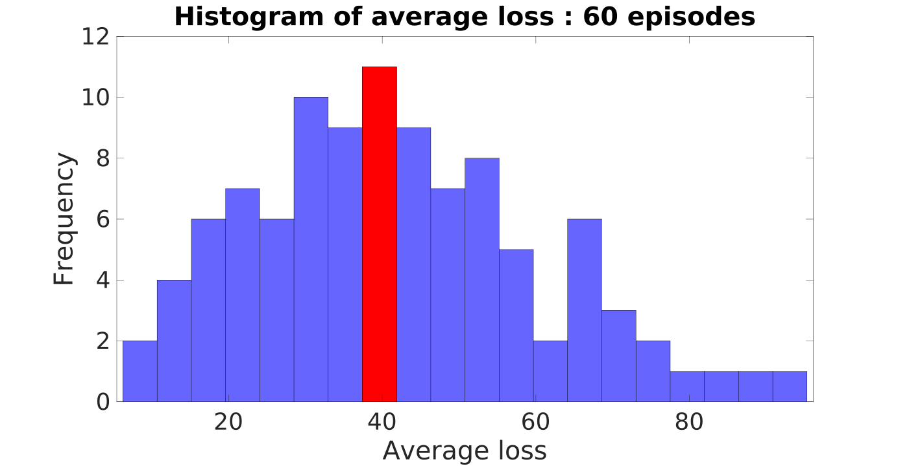</a><br>Loss | <a href="https://htmlpreview.github.io/?https://github.com/Shaadalam9/shipRL-actionresolution/blob/main/docs/figures/gallery/statistics/ppo_loss_00100.html">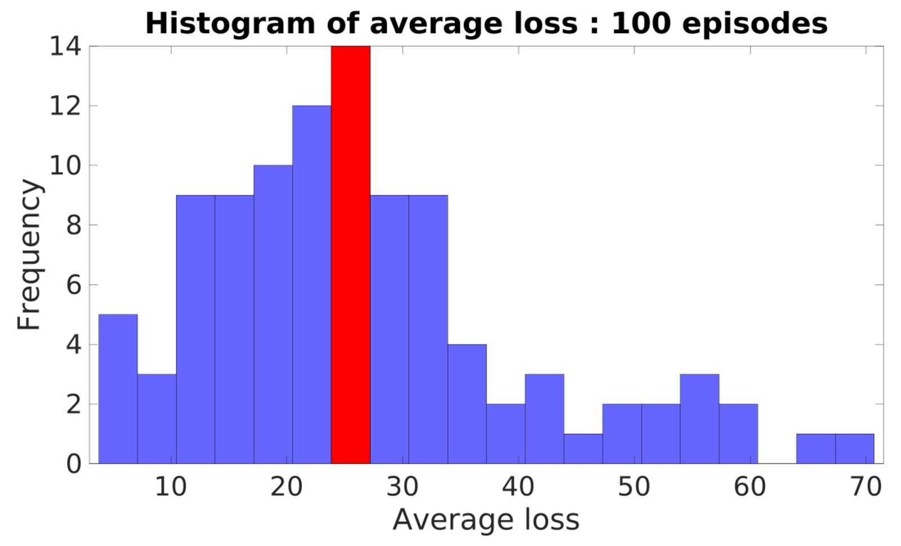</a><br>Loss |
| <a href="https://htmlpreview.github.io/?https://github.com/Shaadalam9/shipRL-actionresolution/blob/main/docs/figures/gallery/statistics/ppo_returns_00020.html">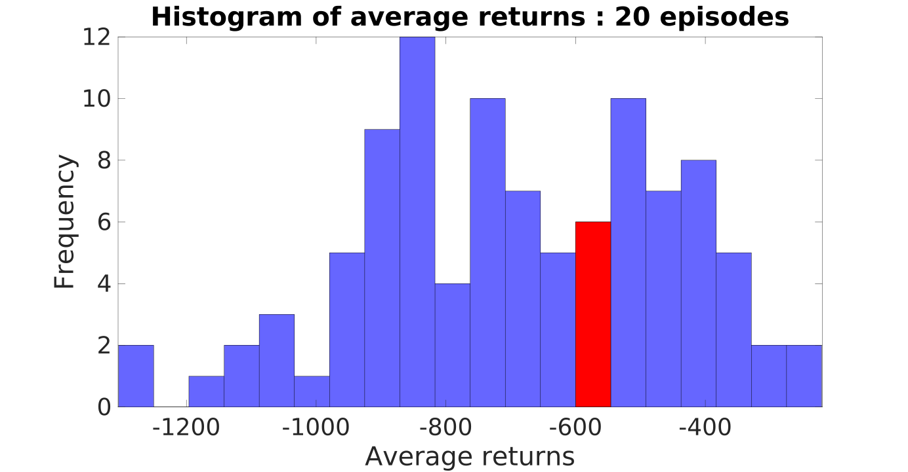</a><br>Return | <a href="https://htmlpreview.github.io/?https://github.com/Shaadalam9/shipRL-actionresolution/blob/main/docs/figures/gallery/statistics/ppo_returns_00040.html">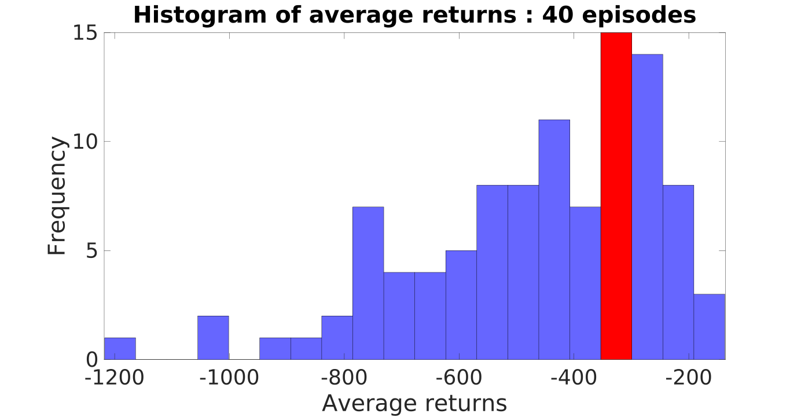</a><br>Return | <a href="https://htmlpreview.github.io/?https://github.com/Shaadalam9/shipRL-actionresolution/blob/main/docs/figures/gallery/statistics/ppo_returns_00060.html">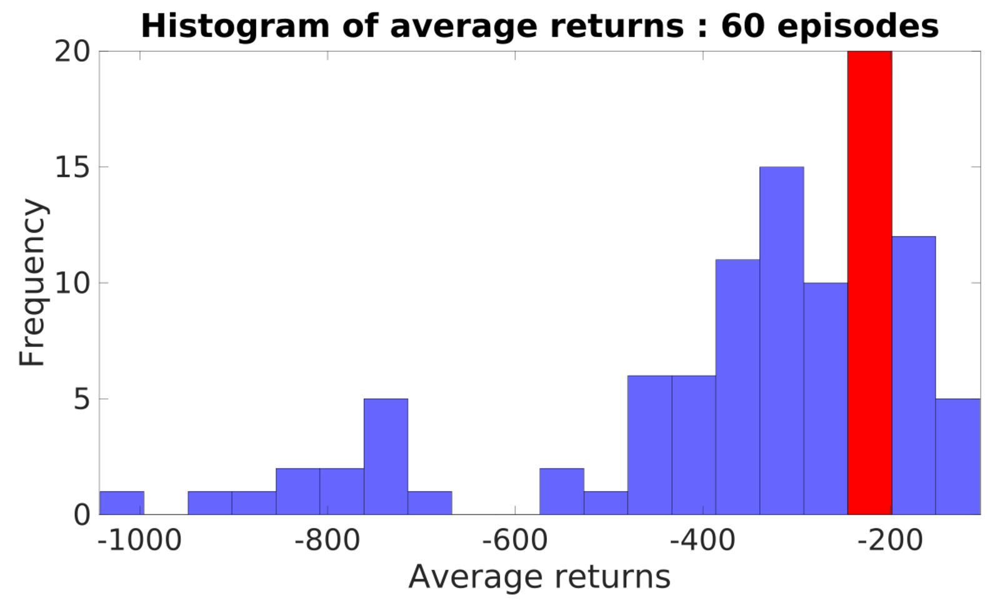</a><br>Return | <a href="https://htmlpreview.github.io/?https://github.com/Shaadalam9/shipRL-actionresolution/blob/main/docs/figures/gallery/statistics/ppo_returns_00100.html">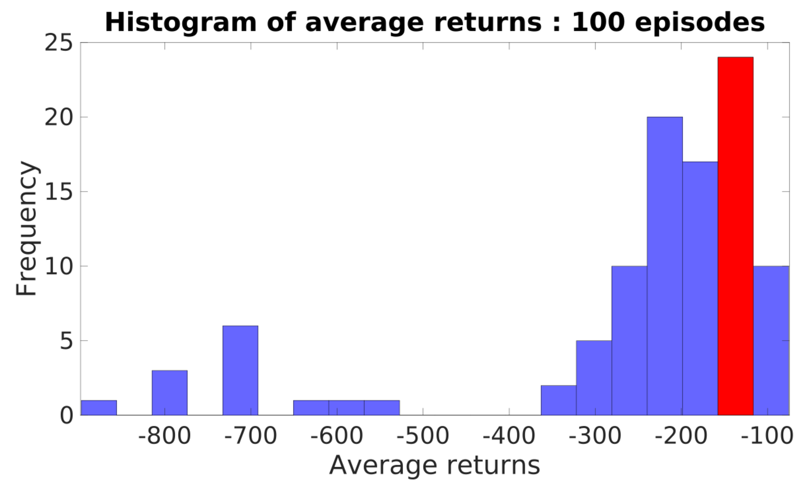</a><br>Return |

**DDPG**

| Episode 2000 | Episode 4000 | Episode 5000 | Episode 7000 | Episode 10000 |
|---|---|---|---|---|
| <a href="https://htmlpreview.github.io/?https://github.com/Shaadalam9/shipRL-actionresolution/blob/main/docs/figures/gallery/statistics/ddpg_loss_02000.html">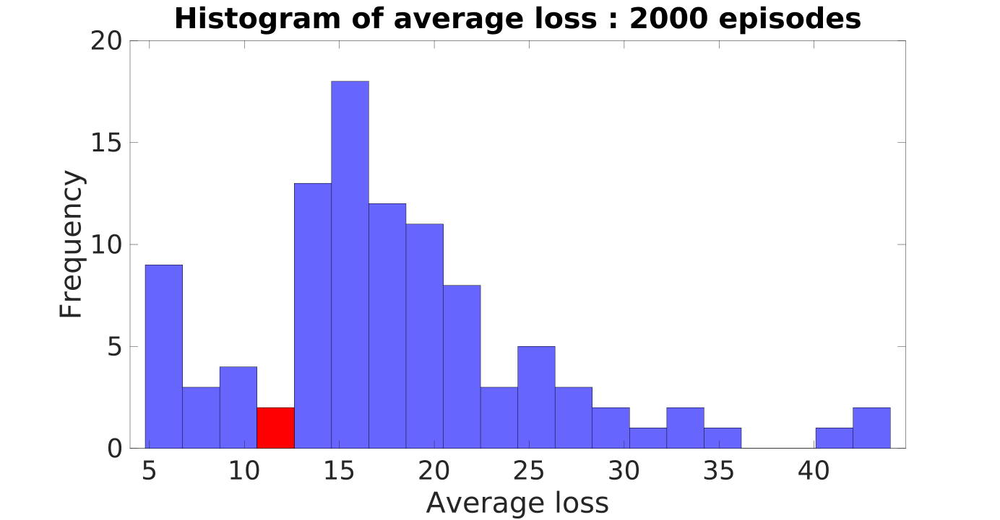</a><br>Loss | <a href="https://htmlpreview.github.io/?https://github.com/Shaadalam9/shipRL-actionresolution/blob/main/docs/figures/gallery/statistics/ddpg_loss_04000.html">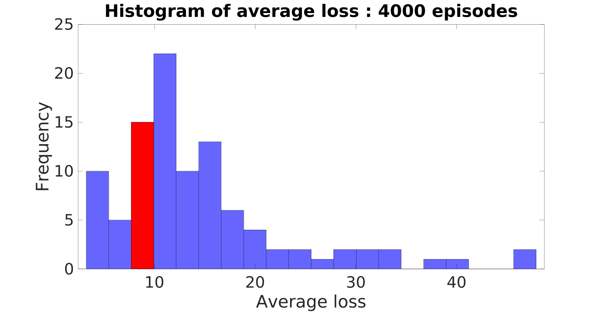</a><br>Loss | <a href="https://htmlpreview.github.io/?https://github.com/Shaadalam9/shipRL-actionresolution/blob/main/docs/figures/gallery/statistics/ddpg_loss_05000.html">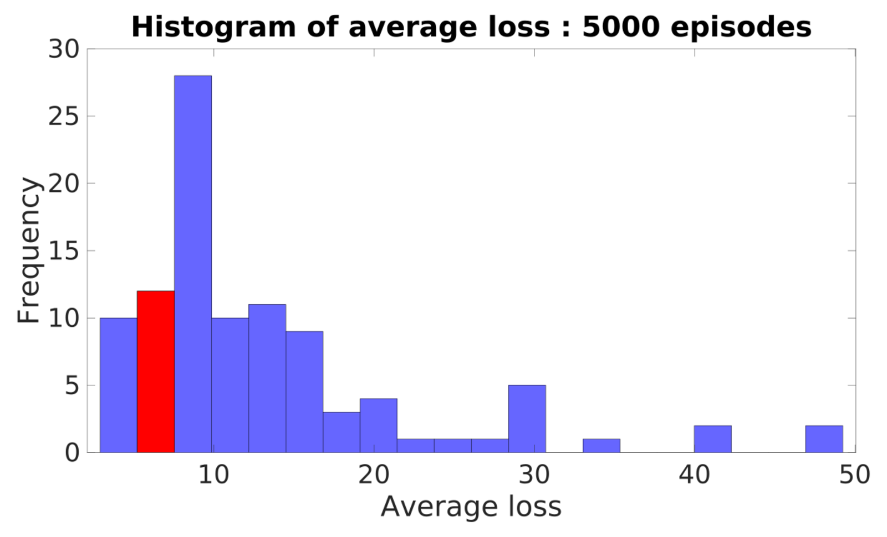</a><br>Loss | <a href="https://htmlpreview.github.io/?https://github.com/Shaadalam9/shipRL-actionresolution/blob/main/docs/figures/gallery/statistics/ddpg_loss_07000.html">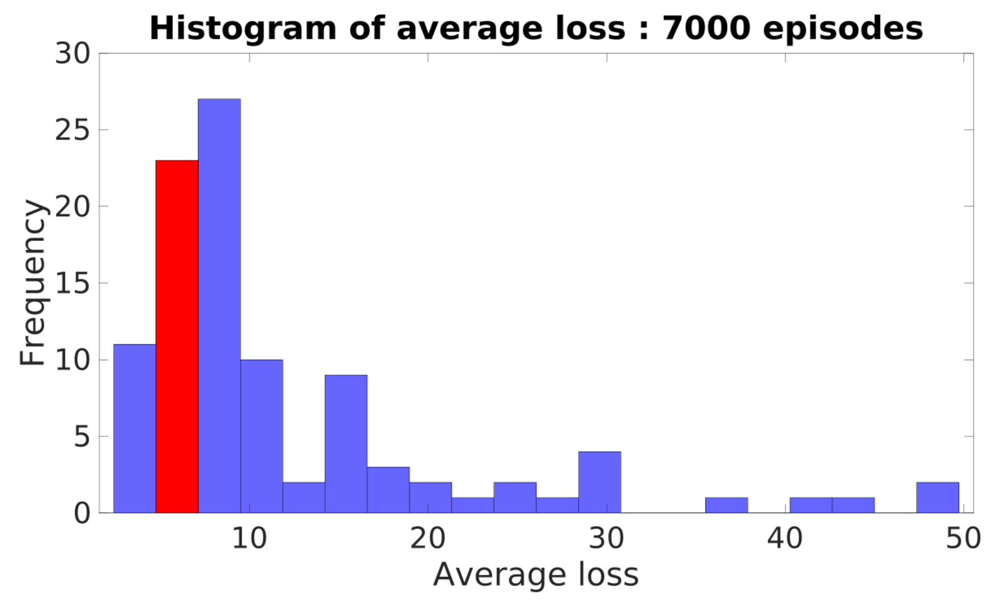</a><br>Loss | <a href="https://htmlpreview.github.io/?https://github.com/Shaadalam9/shipRL-actionresolution/blob/main/docs/figures/gallery/statistics/ddpg_loss_10000.html">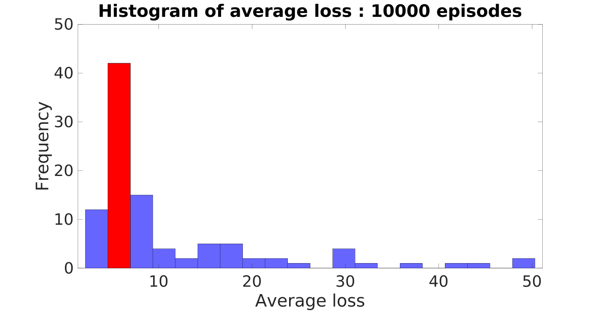</a><br>Loss |
| <a href="https://htmlpreview.github.io/?https://github.com/Shaadalam9/shipRL-actionresolution/blob/main/docs/figures/gallery/statistics/ddpg_returns_02000.html">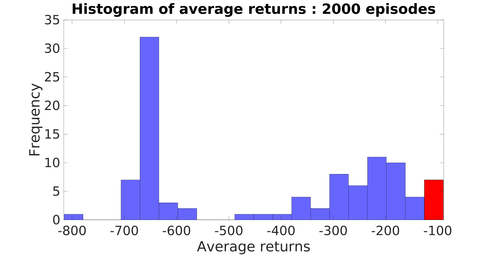</a><br>Return | <a href="https://htmlpreview.github.io/?https://github.com/Shaadalam9/shipRL-actionresolution/blob/main/docs/figures/gallery/statistics/ddpg_returns_04000.html">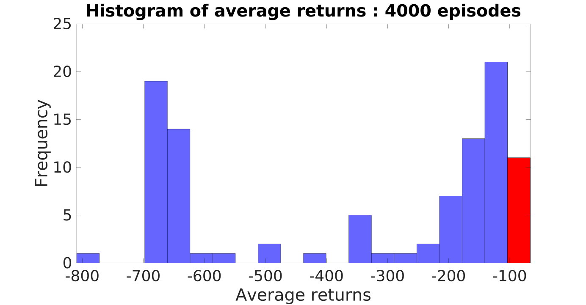</a><br>Return | <a href="https://htmlpreview.github.io/?https://github.com/Shaadalam9/shipRL-actionresolution/blob/main/docs/figures/gallery/statistics/ddpg_returns_05000.html"></a><br>Return | <a href="https://htmlpreview.github.io/?https://github.com/Shaadalam9/shipRL-actionresolution/blob/main/docs/figures/gallery/statistics/ddpg_returns_07000.html"></a><br>Return | <a href="https://htmlpreview.github.io/?https://github.com/Shaadalam9/shipRL-actionresolution/blob/main/docs/figures/gallery/statistics/ddpg_returns_10000.html"></a><br>Return |

### Calm water paths

Simulated tracks of the controllers on the calm water paths of the paper
(Table II), plus the tightening spiral. The dashed line or the markers give
the reference path or its waypoints.

|  |  |  |
|---|---|---|
| <a href="https://htmlpreview.github.io/?https://github.com/Shaadalam9/shipRL-actionresolution/blob/main/docs/figures/gallery/calm/quadrant_1.html"></a><br>Goal (10, 10) L | <a href="https://htmlpreview.github.io/?https://github.com/Shaadalam9/shipRL-actionresolution/blob/main/docs/figures/gallery/calm/quadrant_2.html"></a><br>Goal (−10, 10) L | <a href="https://htmlpreview.github.io/?https://github.com/Shaadalam9/shipRL-actionresolution/blob/main/docs/figures/gallery/calm/quadrant_3.html"></a><br>Goal (−10, −10) L |
| <a href="https://htmlpreview.github.io/?https://github.com/Shaadalam9/shipRL-actionresolution/blob/main/docs/figures/gallery/calm/quadrant_4.html"></a><br>Goal (10, −10) L | <a href="https://htmlpreview.github.io/?https://github.com/Shaadalam9/shipRL-actionresolution/blob/main/docs/figures/gallery/calm/cardioid.html"></a><br>Cardioid | <a href="https://htmlpreview.github.io/?https://github.com/Shaadalam9/shipRL-actionresolution/blob/main/docs/figures/gallery/calm/calmwater_cardioid.html"></a><br>Cardioid, 3 controllers |
| <a href="https://htmlpreview.github.io/?https://github.com/Shaadalam9/shipRL-actionresolution/blob/main/docs/figures/gallery/calm/astroid.html"></a><br>Astroid | <a href="https://htmlpreview.github.io/?https://github.com/Shaadalam9/shipRL-actionresolution/blob/main/docs/figures/gallery/calm/sine.html"></a><br>Sine | <a href="https://htmlpreview.github.io/?https://github.com/Shaadalam9/shipRL-actionresolution/blob/main/docs/figures/gallery/calm/sine_calmwater.html"></a><br>Sine, 3 controllers |
| <a href="https://htmlpreview.github.io/?https://github.com/Shaadalam9/shipRL-actionresolution/blob/main/docs/figures/gallery/calm/star.html"></a><br>Star | <a href="https://htmlpreview.github.io/?https://github.com/Shaadalam9/shipRL-actionresolution/blob/main/docs/figures/gallery/calm/circle.html"></a><br>Circle | <a href="https://htmlpreview.github.io/?https://github.com/Shaadalam9/shipRL-actionresolution/blob/main/docs/figures/gallery/calm/spiral.html"></a><br>Tightening spiral |
| <a href="https://htmlpreview.github.io/?https://github.com/Shaadalam9/shipRL-actionresolution/blob/main/docs/figures/gallery/calm/spiral_final.html"></a><br>Spiral, 3 controllers |  |  |

- **Single destination (10 L, 10 L).** Red: start; blue: goal. DQN 3 cuts closest to the straight line (Table II: RMSE 0.75 L).
- **Single destination (−10 L, 10 L).** The goal lies behind the ship, so every controller first turns through about 180°.
- **Single destination (−10 L, −10 L).** Again a turn of about 180° before the run to the goal.
- **Single destination (10 L, −10 L).** A short turn, then a nearly straight run to the goal.
- **Cardioid.** A closed path with a cusp; PPO tracks it best (Table II: 0.31 L).
- **Cardioid, paper's three controllers.** The same path drawn for DQN 3, DQN 5, and PPO only.
- **Astroid.** Four cusps; the three paper controllers are within 0.03 L of each other (Table II).
- **Sine.** Repeated course reversals over about 95 L.
- **Sine, paper's three controllers.** DQN 5 overshoots one crest near X = 55 L.
- **Star.** Sharp alternating turns; DQN 3 cuts the inner corners (Table II: lowest RMSE, 1.14 L).
- **Circle.** A sustained turn; DQN 5 holds it best with its ±20° commands (Table II: 0.61 L).
- **Tightening spiral.** Curvature grows towards the centre, where the tracks break up.
- **Tightening spiral, paper's three controllers.** The stress test of the paper: DQN 3 reaches 32 of 40 waypoints, PPO 28, DQN 5 27.

### Wind and wave disturbances

The eight disturbance cases of the paper (Tables III and IV). The controllers
were trained in calm water and see neither wind nor waves. Arrows show the wind
and wave directions.

|  |  |  |
|---|---|---|
| <a href="https://htmlpreview.github.io/?https://github.com/Shaadalam9/shipRL-actionresolution/blob/main/docs/figures/gallery/dist/casei.html"></a><br>Case I | <a href="https://htmlpreview.github.io/?https://github.com/Shaadalam9/shipRL-actionresolution/blob/main/docs/figures/gallery/dist/caseii.html"></a><br>Case II | <a href="https://htmlpreview.github.io/?https://github.com/Shaadalam9/shipRL-actionresolution/blob/main/docs/figures/gallery/dist/caseiii.html"></a><br>Case III |
| <a href="https://htmlpreview.github.io/?https://github.com/Shaadalam9/shipRL-actionresolution/blob/main/docs/figures/gallery/dist/caseiv.html"></a><br>Case IV | <a href="https://htmlpreview.github.io/?https://github.com/Shaadalam9/shipRL-actionresolution/blob/main/docs/figures/gallery/dist/casev.html"></a><br>Case V | <a href="https://htmlpreview.github.io/?https://github.com/Shaadalam9/shipRL-actionresolution/blob/main/docs/figures/gallery/dist/casevi.html"></a><br>Case VI |
| <a href="https://htmlpreview.github.io/?https://github.com/Shaadalam9/shipRL-actionresolution/blob/main/docs/figures/gallery/dist/casevii.html"></a><br>Case VII | <a href="https://htmlpreview.github.io/?https://github.com/Shaadalam9/shipRL-actionresolution/blob/main/docs/figures/gallery/dist/caseviii.html"></a><br>Case VIII | <a href="https://htmlpreview.github.io/?https://github.com/Shaadalam9/shipRL-actionresolution/blob/main/docs/figures/gallery/dist/cardioid_disturbance.html"></a><br>Cardioid, 3 controllers |
| <a href="https://htmlpreview.github.io/?https://github.com/Shaadalam9/shipRL-actionresolution/blob/main/docs/figures/gallery/dist/sine_disturbance.html"></a><br>Sine, 3 controllers |  |  |

- **Case I.** Figure eight; wind 6U in direction π/2, waves 3 m and 10 s in direction π/4.
- **Case II.** Figure eight; wind 6U in direction −π/2, waves 3 m and 10 s in direction −π/2.
- **Case III.** Cardioid; wind 3U in direction 0, waves 2 m and 15 s in direction 0.
- **Case IV.** Cardioid; wind 5U in direction π/4, waves 2 m and 15 s in direction 0.
- **Case V.** Sine; wind 6U in direction π, waves 3 m and 8 s in direction π.
- **Case VI.** Sine; wind 3U in direction π/2, waves 3 m and 8 s in direction π/2.
- **Case VII.** Astroid; wind 4U in direction 3π/4, waves 2 m and 10 s in direction 3π/4.
- **Case VIII.** Astroid; wind 4U in direction π/4, waves 3 m and 20 s in direction −π/4.
- **Cardioid in wind and waves, three controllers.** Magenta arrow: wind; cyan arrow: waves.
- **Sine in wind and waves, three controllers.** Magenta arrow: wind; cyan arrow: waves.

### Measurement noise

Not in the paper: tracks on five paths in a noise study of the original work.
The noise settings are not recorded with these figures.

|  |  |  |
|---|---|---|
| <a href="https://htmlpreview.github.io/?https://github.com/Shaadalam9/shipRL-actionresolution/blob/main/docs/figures/gallery/noise/casei_noise.html"></a><br>Case I | <a href="https://htmlpreview.github.io/?https://github.com/Shaadalam9/shipRL-actionresolution/blob/main/docs/figures/gallery/noise/caseii_noise.html"></a><br>Case II | <a href="https://htmlpreview.github.io/?https://github.com/Shaadalam9/shipRL-actionresolution/blob/main/docs/figures/gallery/noise/caseiii_noise.html"></a><br>Case III |
| <a href="https://htmlpreview.github.io/?https://github.com/Shaadalam9/shipRL-actionresolution/blob/main/docs/figures/gallery/noise/caseiv_noise.html"></a><br>Case IV | <a href="https://htmlpreview.github.io/?https://github.com/Shaadalam9/shipRL-actionresolution/blob/main/docs/figures/gallery/noise/casev_noise.html"></a><br>Case V |  |

- **Case I.** Circle.
- **Case II.** Figure eight.
- **Case III.** Cardioid.
- **Case IV.** Sine.
- **Case V.** Astroid.

### Model-scale experiment against simulation

The square path of Fig. 2 of the paper, comparing the measured run with the
same policy in simulation: course angle error (rad) and cross-track error
(ship lengths) against time step, and the trajectory in ship lengths. These
show what the paper describes without a figure: course angle follows the
simulation closely, while the cross-track error departs from it after each
waypoint change.

| Course angle error | Trajectory | Cross-track error |
|---|---|---|
| <a href="https://htmlpreview.github.io/?https://github.com/Shaadalam9/shipRL-actionresolution/blob/main/docs/figures/gallery/experiment/dqn_3_cae.html"></a><br>DQN, 3 actions, course | <a href="https://htmlpreview.github.io/?https://github.com/Shaadalam9/shipRL-actionresolution/blob/main/docs/figures/gallery/experiment/dqn_3_xy.html"></a><br>DQN, 3 actions, track | <a href="https://htmlpreview.github.io/?https://github.com/Shaadalam9/shipRL-actionresolution/blob/main/docs/figures/gallery/experiment/dqn_3_ype.html"></a><br>DQN, 3 actions, cross-track |
| <a href="https://htmlpreview.github.io/?https://github.com/Shaadalam9/shipRL-actionresolution/blob/main/docs/figures/gallery/experiment/dqn_5_cae.html"></a><br>DQN, 5 actions, course | <a href="https://htmlpreview.github.io/?https://github.com/Shaadalam9/shipRL-actionresolution/blob/main/docs/figures/gallery/experiment/dqn_5_xy.html"></a><br>DQN, 5 actions, track | <a href="https://htmlpreview.github.io/?https://github.com/Shaadalam9/shipRL-actionresolution/blob/main/docs/figures/gallery/experiment/dqn_5_ype.html"></a><br>DQN, 5 actions, cross-track |
| <a href="https://htmlpreview.github.io/?https://github.com/Shaadalam9/shipRL-actionresolution/blob/main/docs/figures/gallery/experiment/ppo_cae.html"></a><br>PPO, course | <a href="https://htmlpreview.github.io/?https://github.com/Shaadalam9/shipRL-actionresolution/blob/main/docs/figures/gallery/experiment/ppo_xy.html"></a><br>PPO, track | <a href="https://htmlpreview.github.io/?https://github.com/Shaadalam9/shipRL-actionresolution/blob/main/docs/figures/gallery/experiment/ppo_ype.html"></a><br>PPO, cross-track |

- **DQN, 3 actions, course angle error.** Experiment (blue) against simulation (orange).
- **DQN, 3 actions, trajectory.** Measured (blue, solid) against simulated (red, dashed), with the waypoints.
- **DQN, 3 actions, cross-track error.** Experiment (blue) against simulation (orange).
- **DQN, 5 actions, course angle error.** Experiment (blue) against simulation (orange).
- **DQN, 5 actions, trajectory.** Measured (blue, solid) against simulated (red, dashed), with the waypoints.
- **DQN, 5 actions, cross-track error.** Experiment (blue) against simulation (orange).
- **PPO, course angle error.** Experiment (blue) against simulation (orange).
- **PPO, trajectory.** Measured (blue, solid) against simulated (red, dashed), with the waypoints.
- **PPO, cross-track error.** Experiment (blue) against simulation (orange).

### Earlier `analyze.py` run

Not in the paper: output of `scripts/analyze.py` for DQN 3, DQN 5, and PPO
before the common 0.5 L arrival radius became the default, so each controller
used its own trained radius (1.5 L for DQN 5). The rudder angle is in degrees
here. The current default run is described under
[Reproducing the paper](#reproducing-the-paper).

| Track | Cross-track error | Rudder angle |
|---|---|---|
| <a href="https://htmlpreview.github.io/?https://github.com/Shaadalam9/shipRL-actionresolution/blob/main/docs/figures/gallery/earlier_analysis/track_straight.html"></a><br>Straight, tracks | <a href="https://htmlpreview.github.io/?https://github.com/Shaadalam9/shipRL-actionresolution/blob/main/docs/figures/gallery/earlier_analysis/cross_track_error_straight.html"></a><br>Straight, cross-track | <a href="https://htmlpreview.github.io/?https://github.com/Shaadalam9/shipRL-actionresolution/blob/main/docs/figures/gallery/earlier_analysis/rudder_angle_straight.html"></a><br>Straight, rudder |
| <a href="https://htmlpreview.github.io/?https://github.com/Shaadalam9/shipRL-actionresolution/blob/main/docs/figures/gallery/earlier_analysis/track_ellipse.html"></a><br>Ellipse, tracks | <a href="https://htmlpreview.github.io/?https://github.com/Shaadalam9/shipRL-actionresolution/blob/main/docs/figures/gallery/earlier_analysis/cross_track_error_ellipse.html"></a><br>Ellipse, cross-track | <a href="https://htmlpreview.github.io/?https://github.com/Shaadalam9/shipRL-actionresolution/blob/main/docs/figures/gallery/earlier_analysis/rudder_angle_ellipse.html"></a><br>Ellipse, rudder |
| <a href="https://htmlpreview.github.io/?https://github.com/Shaadalam9/shipRL-actionresolution/blob/main/docs/figures/gallery/earlier_analysis/track_cardioid.html"></a><br>Cardioid, tracks | <a href="https://htmlpreview.github.io/?https://github.com/Shaadalam9/shipRL-actionresolution/blob/main/docs/figures/gallery/earlier_analysis/cross_track_error_cardioid.html"></a><br>Cardioid, cross-track | <a href="https://htmlpreview.github.io/?https://github.com/Shaadalam9/shipRL-actionresolution/blob/main/docs/figures/gallery/earlier_analysis/rudder_angle_cardioid.html"></a><br>Cardioid, rudder |
| <a href="https://htmlpreview.github.io/?https://github.com/Shaadalam9/shipRL-actionresolution/blob/main/docs/figures/gallery/earlier_analysis/track_figure_eight.html"></a><br>Figure eight, tracks | <a href="https://htmlpreview.github.io/?https://github.com/Shaadalam9/shipRL-actionresolution/blob/main/docs/figures/gallery/earlier_analysis/cross_track_error_figure_eight.html"></a><br>Figure eight, cross-track | <a href="https://htmlpreview.github.io/?https://github.com/Shaadalam9/shipRL-actionresolution/blob/main/docs/figures/gallery/earlier_analysis/rudder_angle_figure_eight.html"></a><br>Figure eight, rudder |
| <a href="https://htmlpreview.github.io/?https://github.com/Shaadalam9/shipRL-actionresolution/blob/main/docs/figures/gallery/earlier_analysis/track_star.html"></a><br>Star, tracks | <a href="https://htmlpreview.github.io/?https://github.com/Shaadalam9/shipRL-actionresolution/blob/main/docs/figures/gallery/earlier_analysis/cross_track_error_star.html"></a><br>Star, cross-track | <a href="https://htmlpreview.github.io/?https://github.com/Shaadalam9/shipRL-actionresolution/blob/main/docs/figures/gallery/earlier_analysis/rudder_angle_star.html"></a><br>Star, rudder |

- **Straight, cross-track error.** In ship lengths, per step.
- **Straight, realised rudder angle.** In degrees, per step.
- **Ellipse, cross-track error.** In ship lengths, per step.
- **Ellipse, realised rudder angle.** In degrees, per step.
- **Cardioid, cross-track error.** In ship lengths, per step.
- **Cardioid, realised rudder angle.** In degrees, per step.
- **Figure eight, cross-track error.** In ship lengths, per step.
- **Figure eight, realised rudder angle.** In degrees, per step.
- **Star, cross-track error.** In ship lengths, per step.
- **Star, realised rudder angle.** In degrees, per step.

|  |  |  |
|---|---|---|
| <a href="https://htmlpreview.github.io/?https://github.com/Shaadalam9/shipRL-actionresolution/blob/main/docs/figures/gallery/earlier_analysis/summary_cross_track_rmse.html"></a><br>Cross-track RMSE | <a href="https://htmlpreview.github.io/?https://github.com/Shaadalam9/shipRL-actionresolution/blob/main/docs/figures/gallery/earlier_analysis/summary_rudder_effort.html"></a><br>Mean rudder angle | <a href="https://htmlpreview.github.io/?https://github.com/Shaadalam9/shipRL-actionresolution/blob/main/docs/figures/gallery/earlier_analysis/summary_table.html"></a><br>Summary table |

- **Cross-track RMSE.** In ship lengths, per path and controller.
- **Mean absolute rudder angle.** In degrees, per path and controller.
- **Summary table.** RMSE, mean rudder angle, steps, and completion per path and controller.

## Figures

Every figure is written in three formats:

| Format | For |
|---|---|
| **PNG** | documents, slides, the README |
| **PDF** | publication, vector quality at any zoom |
| **HTML** | an interactive version — pan, zoom, and hover any track to read values |

Pass `--format png` (repeatable) to `analyze.py` or `evaluate.py` to write only
some of them. Figures are built with [Plotly](https://plotly.com/python/);
static PNG and PDF export goes through `kaleido`, which `uv sync` installs.

Figures carry **no title and no subtitle** — they are meant to be dropped into a
paper or report where the caption names the figure, so a baked-in title would
duplicate that caption and waste vertical space. Axis labels and the legend do
the explanatory work; the conditions a result was produced under are recorded in
the accompanying `results.json` and printed by the script that generated it.

The categorical colours were validated for colour-vision deficiency across all
pairs, so the four controllers stay distinguishable when overlaid. Identity
never rests on colour alone: every figure carries a legend, bars are labelled
with their values, and the analysis writes a summary table beside the charts.

## Layout

```
asv_rl/                    the library
├── dynamics/kcs.py        3-DOF MMG model of the KCS hull
├── envs/ship_env.py       the waypoint-following task
├── agents/                DQN, DDPG, PPO + the registry that selects one
├── training/              the two training loops and run artefacts
├── evaluation/            reference paths, rollout metrics, Plotly figures
└── config.py              typed configuration loaded from YAML

configs/                   one YAML per experiment
models/<experiment>/<run>/ trained policies, each with its own config
scripts/train.py           training entry point
scripts/evaluate.py        evaluate one policy
scripts/analyze.py         compare the policies listed in `config`
scripts/paper_figures.py   draw Fig. 1 of the paper and the README summary figures
docs/figures/              README figures, incl. Figs. 1 and 2 of the paper (PNG + HTML)
asv_rl/settings.py         project-wide settings read from `config`
config                     which controllers to compare, figure font, log level
docker/                    build and run scripts for the training image
```

## The task

**Observation** (4 values): cross-track error, course angle error, distance to
the goal, and yaw rate.

**Action**: a commanded rudder angle, either chosen from a fixed set (DQN) or
continuous (DDPG, PPO). The actuator has a first-order lag and a 5°/s rate
limit, so the commanded angle is not the realised one.

**Reward**, per step:

```
  2.0 * exp(-0.08 * cross_track_error²) - 1.0     stay on the line
+ 1.3 * exp(-10 * |course_angle_error|) - 0.3     point the right way
- 0.25 * distance_to_goal                         make progress
```

with a bonus on reaching the goal. Every coefficient is configurable under
`environment.reward`.

**Episode end**: the goal is reached (within `arrival_radius`), the ship
overshoots and is heading away from the goal, or the step limit expires.

## Configuration

### Project settings: the `config` file

[`config`](config) is a small JSON file of settings that are not part of any one
experiment. It is read at start-up, with [`default.config`](default.config) as
the fallback:

| Key | Effect |
|---|---|
| `agents` | Controllers `scripts/analyze.py` compares, in plot order. The default is the paper's three, `dqn_3_action`, `dqn_5_action`, and `ppo`; add `ddpg` for the four-way comparison. |
| `font_family` | Font of every figure |
| `font_size` | Base font size of every figure; legends, ticks, and value labels sit two points below it |
| `plotly_template` | Plotly template underlying every figure |
| `decimal_places` | Decimals on every number a figure draws: axis ticks, bar value labels, hover readouts, and the summary table |
| `logger_level` | Log level of the three scripts |

`config` is not tracked, so each machine can keep its own; copy `default.config`
to `config` to start from the shipped values.

### Experiment settings: the YAML configs

One YAML file describes an entire run — environment, agent, and training
schedule — and is copied into the run directory, so a trained policy always
travels with the settings that produced it. Unknown keys are rejected, so a
misspelled hyperparameter fails loudly instead of being silently ignored:

```
$ uv run scripts/train.py configs/ddpg.yaml --dry-run
Configuration error: agent: unknown option(s) ['discont'].
Valid options are ['actor', 'critic', 'discount', 'exploration', ...].
```

Override any option from the command line, which is how parameter sweeps are
run:

```bash
# A short smoke test
uv run scripts/train.py configs/ppo.yaml --dry-run
uv run scripts/train.py configs/ppo.yaml \
    --set training.iterations=2 --set training.episodes_per_iteration=2 \
    --run-name smoke_test

# A seed sweep
for seed in 12345 43738 95832; do
    uv run scripts/train.py configs/dqn_5_action.yaml \
        --set seed=$seed --run-name "seed_$seed"
done

# Train in wind rather than calm water
uv run scripts/train.py configs/ddpg.yaml \
    --set environment.conditions.wind.enabled=true \
    --set environment.conditions.wind.speed=6 \
    --run-name wind_6
```

`--dry-run` prints the fully resolved config and exits, which is the cheapest
way to confirm a sweep is doing what you think.

## Evaluating one policy

Thirteen reference paths are available; `uv run scripts/evaluate.py
--list-trajectories` prints them. Without `--trajectory`, the paper's calm water
paths are run. Each rollout reports cross-track RMSE, mean absolute rudder angle
(a proxy for actuator wear), and whether the path was completed. As in
`analyze.py`, the arrival radius is 0.5 L unless `--arrival-radius` says
otherwise.

Because every controller here was trained in calm water, the interesting
experiment is evaluating outside those conditions:

```bash
uv run scripts/evaluate.py models/ppo/calm_water_v1 \
    --trajectory figure_eight --wind-speed 6 --wind-dir 90

uv run scripts/evaluate.py models/dqn_5_action/calm_water_v1 \
    --trajectory cardioid --wave-height 2 --wave-period 15 --wave-dir 0
```

## Adding an algorithm

Write a module in `asv_rl/agents/` exposing a config dataclass and a
`build_agent(tf_env, config, train_step_counter)` function, then add one
`AlgorithmSpec` entry to `asv_rl/agents/registry.py`. If it is off-policy with
a replay buffer or on-policy with fresh batches, an existing training loop will
already run it; nothing else needs to change.

## Linting

CI runs [Super-linter](https://github.com/super-linter/super-linter) over
changed files, configured in [`.github/workflows/linter.yml`](.github/workflows/linter.yml).
The enabled validators are flake8, Ruff, YAML (including Prettier formatting),
GitHub Actions, and jscpd duplicate detection. Their configs live in
`.github/linters/`, and **all three Python line-length settings are 119** —
`.flake8`, `.python-lint`, and `.ruff.toml` must agree or the linters
contradict each other.

To reproduce a CI run locally:

```bash
uv run --with ruff ruff check --config .github/linters/.ruff.toml asv_rl scripts
uv run --with flake8 python -m flake8 --config .github/linters/.flake8 asv_rl scripts
npx prettier --check "configs/*.yaml" ".github/**/*.yml"
npx jscpd --config .github/linters/.jscpd.json .
```

## Dependency notes

The pinned ranges in `pyproject.toml` are load-bearing, not caution:

- **`tensorflow >= 2.14, < 2.15`** — TensorFlow 2.16 made Keras 3 the default,
  and `tf-agents` still needs the Keras 2 API; it fails to import against
  Keras 3.
- **`numpy < 2`** — TensorFlow below 2.16 is built against the NumPy 1.x ABI
  and segfaults on import with NumPy 2.
- **`tensorflow-macos` on Apple Silicon** — for these versions the PyPI
  `tensorflow` wheel for macOS arm64 is an empty shim; the real package is
  `tensorflow-macos`.
- **`tensorflow-probability >= 0.22, < 0.23`** — it asserts a minimum
  TensorFlow version at import time, so it has to match the TensorFlow pin.

## Behaviour changes from the pre-restructure code

The physics and the reward are unchanged — the unified environment reproduces
the originals to the bit across both action-space types. These behavioural
differences are deliberate, and mean a rerun will not reproduce a released
checkpoint step for step:

- **PPO trained twice per iteration.** The original called `agent.train()` once
  discarding the result and again to read the loss, giving two full 10-epoch
  updates per batch. It now trains once.
- **DDPG's learning rate decay was dead code.** Exponential decay schedules
  were constructed and never passed to the optimisers. The configs record the
  constant rate that actually ran; set `decay_steps` and `decay_rate` to enable
  decay.
- **Exploration noise no longer goes negative.** DDPG's noise scale decayed
  linearly past zero, which would raise `ValueError` from `np.random.normal`
  after episode 9000 of a 10001-episode run. It is now clamped at zero.
- **The initial course-angle error in evaluation was measured from the origin**
  rather than from the starting waypoint, which was wrong whenever a path did
  not start at (0, 0). It now uses the bearing from the ship's actual position.
- **`np.cross` on 2-D vectors** was removed in NumPy 2.0; the cross-track error
  is now written out explicitly, so the code is not tied to NumPy 1.x.
- **The replay dataset iterator is created once** instead of being rebuilt on
  every update. This samples identically and is considerably faster.
- **Figures are Plotly, not matplotlib**, and training history is written as
  `training_history.json` rather than a MATLAB `.mat` file. The only remaining
  `.mat` file is `asv_rl/dynamics/data/KCS_drift.mat`, the wave drift
  coefficient table the hull model reads.
- **Per-episode goal coordinates are no longer printed** during training. Pass
  `verbose=True` to `ShipEnv` to restore it; the training loop prints a
  windowed average instead.

## Getting help

Email R S Sanjeev Kumar (`sanjeevrs2000@gmail.com`), Md. Shadab Alam
(`shaadalam.5u@gmail.com`), or the supervisor Abhilash Somayajula
(`abhilash@iitm.ac.in`). Pull requests are welcome.

## Maintainers

Maintained by the Marine Autonomous Vessels (MAV) Laboratory in the Department
of Ocean Engineering at IIT Madras. Originally undertaken by Rohit Deraj,
R S Sanjeev Kumar, and Md. Shadab Alam, supervised by Abhilash Somayajula.

## License

[MIT](LICENSE).
