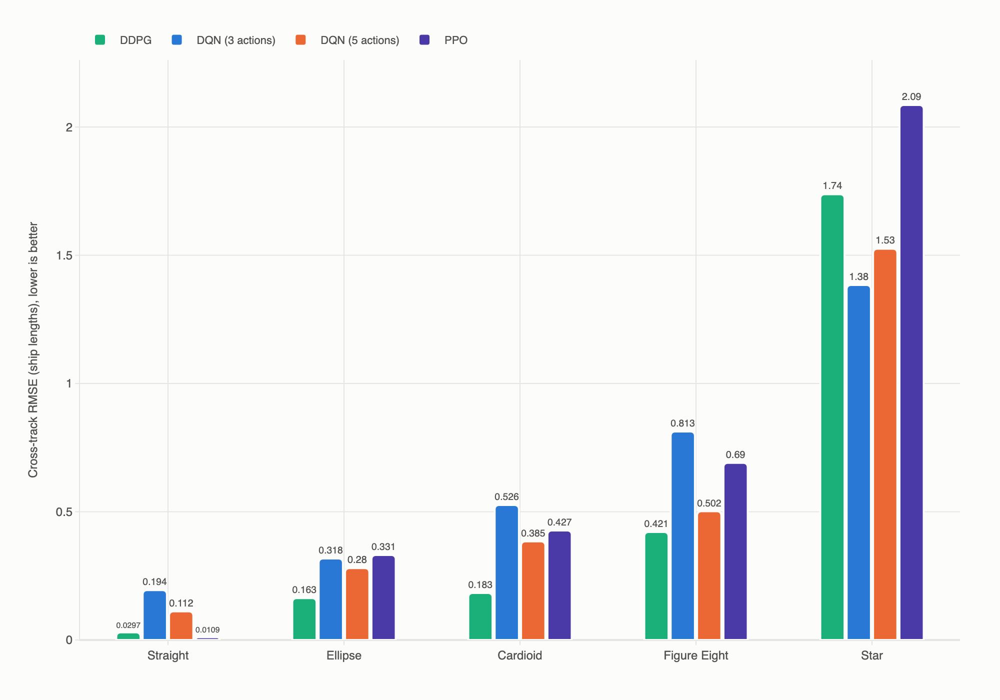
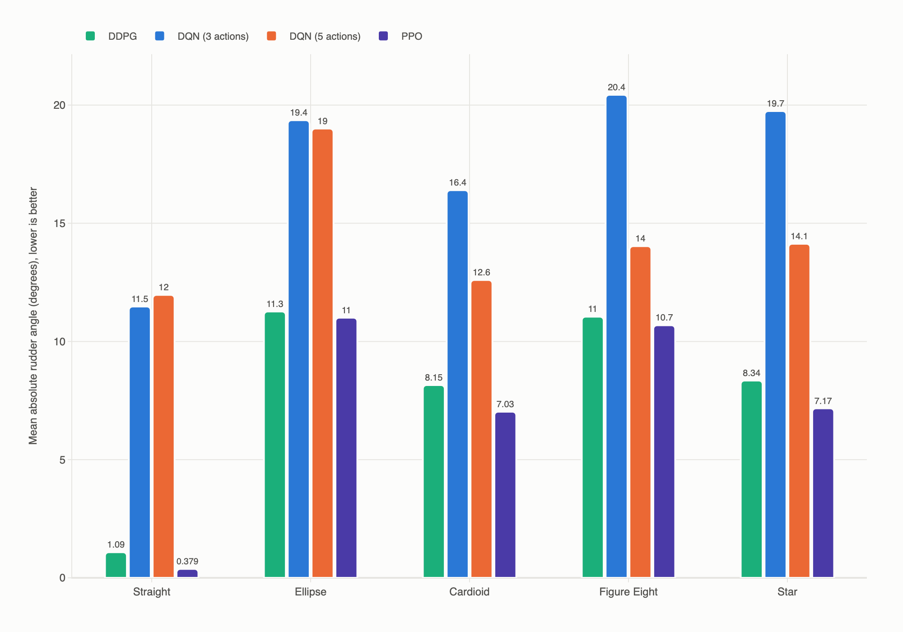

# Reinforcement learning for ASV path following

Four reinforcement learning controllers steer the rudder of the KRISO Container
Ship (KCS) to follow a path, trained and evaluated against one shared 3-DOF
maneuvering model so that the comparison is between the algorithms rather than
between four copies of the task.

| Controller | Rudder command | Config | Released policy |
|---|---|---|---|
| DQN, 3 actions | −35°, 0°, +35° | [`configs/dqn_3_action.yaml`](configs/dqn_3_action.yaml) | [`models/dqn_3_action/calm_water_v1`](models/dqn_3_action/calm_water_v1) |
| DQN, 5 actions | −35°, −20°, 0°, +20°, +35° | [`configs/dqn_5_action.yaml`](configs/dqn_5_action.yaml) | [`models/dqn_5_action/calm_water_v1`](models/dqn_5_action/calm_water_v1) |
| DDPG | continuous, ±35° | [`configs/ddpg.yaml`](configs/ddpg.yaml) | [`models/ddpg/calm_water_v1`](models/ddpg/calm_water_v1) |
| PPO | continuous, ±35° | [`configs/ppo.yaml`](configs/ppo.yaml) | [`models/ppo/calm_water_v1`](models/ppo/calm_water_v1) |

## Why

Most marine accidents are attributable to human decision error, so automating
the path-following action of a ship is worth doing well. A 3-DOF MMG model
describes the ship's motion; the KCS hull is used because it is a benchmark
with published hydrodynamic coefficients. An agent is trained to interact with
that numerical model to achieve waypoint tracking, and the resulting controller
is then evaluated in wind and waves it never saw during training.

## Quick start

The project is managed with [uv](https://docs.astral.sh/uv/).

```bash
uv sync                          # create the environment from uv.lock

uv run scripts/analyze.py        # run the controllers in `config` and compare them
uv run scripts/train.py configs/ddpg.yaml --run-name my_run
uv run scripts/evaluate.py models/ddpg/calm_water_v1
```

`uv sync` installs the exact pinned set from `uv.lock`; `uv run` executes inside
that environment without activating anything. To add a package, use
`uv add <package>` rather than editing `pyproject.toml` by hand.

<details>
<summary>Without uv</summary>

```bash
python -m venv .venv && source .venv/bin/activate
pip install -r requirements.txt
python scripts/analyze.py
```

`requirements.txt` is a convenience mirror of the dependencies; `pyproject.toml`
is the source of truth.
</details>

### With Docker

The image pins the versions the released policies were trained with.

```bash
./docker/build.sh
./docker/run.sh                                          # interactive shell
./docker/run.sh python scripts/train.py configs/ppo.yaml # or run directly
```

The repository is bind-mounted into the container, so edits on the host take
effect immediately. GPUs are requested only when the host exposes them, and
figures are written to disk rather than displayed, so no X11 forwarding is
needed.

## The comparison

`scripts/analyze.py` is the headline experiment: it loads the trained policy of
every controller listed under `agents` in the [`config`](config) file, runs each
one over the same reference paths under the same conditions, and writes the
comparison figures. Edit that list to change which controllers take part —
`--model NAME=PATH` overrides it for a single run.

```bash
uv run scripts/analyze.py                                       # calm water
uv run scripts/analyze.py --wind-speed 6 --wind-dir 90          # in wind
uv run scripts/analyze.py --trajectory star --trajectory spiral # chosen paths
```

Results in calm water, over the five default paths:



*Cross-track RMSE by controller and reference path, calm water.*



*Mean absolute rudder angle by controller and reference path, calm water.*

The continuous-rudder controllers track a straight line an order of magnitude
more tightly than the discrete ones and use far less rudder to do it, while the
three-action DQN pays for its coarse action set with both the worst tracking
error and the highest actuator activity. On sharply cornered paths the ordering
is less clear-cut — the star path defeats all four to different degrees.


*Paths followed on the figure-of-eight, calm water.*

Each run writes, per reference path, a track plot, a cross-track error series,
and a rudder angle series, plus three summary figures and a `results.json`.
Output goes to `analysis/`, which is not committed — regenerate it with the
command above.

## Figures

Every figure is written in three formats:

| Format | For |
|---|---|
| **PNG** | documents, slides, the README |
| **PDF** | publication, vector quality at any zoom |
| **HTML** | an interactive version — pan, zoom, and hover any track to read values |

Pass `--format png` (repeatable) to `analyze.py` or `evaluate.py` to write only
some of them. Figures are built with [Plotly](https://plotly.com/python/);
static PNG and PDF export goes through `kaleido`, which `uv sync` installs.

Figures carry **no title and no subtitle** — they are meant to be dropped into a
paper or report where the caption names the figure, so a baked-in title would
duplicate that caption and waste vertical space. Axis labels and the legend do
the explanatory work; the conditions a result was produced under are recorded in
the accompanying `results.json` and printed by the script that generated it.

The categorical colours were validated for colour-vision deficiency across all
pairs, so the four controllers stay distinguishable when overlaid. Identity
never rests on colour alone: every figure carries a legend, bars are labelled
with their values, and the analysis writes a summary table beside the charts.

## Layout

```
asv_rl/                    the library
├── dynamics/kcs.py        3-DOF MMG model of the KCS hull
├── envs/ship_env.py       the waypoint-following task
├── agents/                DQN, DDPG, PPO + the registry that selects one
├── training/              the two training loops and run artefacts
├── evaluation/            reference paths, rollout metrics, Plotly figures
└── config.py              typed configuration loaded from YAML

configs/                   one YAML per experiment
models/<experiment>/<run>/ trained policies, each with its own config
scripts/train.py           training entry point
scripts/evaluate.py        evaluate one policy
scripts/analyze.py         compare the policies listed in `config`
asv_rl/settings.py         project-wide settings read from `config`
config                     which controllers to compare, figure font, log level
docker/                    build and run scripts for the training image
```

## The task

**Observation** (4 values): cross-track error, course angle error, distance to
the goal, and yaw rate.

**Action**: a commanded rudder angle, either chosen from a fixed set (DQN) or
continuous (DDPG, PPO). The actuator has a first-order lag and a 5°/s rate
limit, so the commanded angle is not the realised one.

**Reward**, per step:

```
  2.0 * exp(-0.08 * cross_track_error²) - 1.0     stay on the line
+ 1.3 * exp(-10 * |course_angle_error|) - 0.3     point the right way
- 0.25 * distance_to_goal                         make progress
```

with a bonus on reaching the goal. Every coefficient is configurable under
`environment.reward`.

**Episode end**: the goal is reached (within `arrival_radius`), the ship
overshoots and is heading away from the goal, or the step limit expires.

## Configuration

### Project settings: the `config` file

[`config`](config) is a small JSON file of settings that are not part of any one
experiment. It is read at start-up, with [`default.config`](default.config) as
the fallback:

| Key | Effect |
|---|---|
| `agents` | Controllers `scripts/analyze.py` compares, in plot order. The default drops `dqn_3_action` and compares `dqn_5_action`, `ddpg`, and `ppo`; add it back for the four-way comparison. |
| `font_family` | Font of every figure |
| `font_size` | Base font size of every figure; legends, ticks, and value labels sit two points below it |
| `plotly_template` | Plotly template underlying every figure |
| `decimal_places` | Decimals on every number a figure draws: axis ticks, bar value labels, hover readouts, and the summary table |
| `logger_level` | Log level of the three scripts |

`config` is not tracked, so each machine can keep its own; copy `default.config`
to `config` to start from the shipped values.

### Experiment settings: the YAML configs

One YAML file describes an entire run — environment, agent, and training
schedule — and is copied into the run directory, so a trained policy always
travels with the settings that produced it. Unknown keys are rejected, so a
misspelled hyperparameter fails loudly instead of being silently ignored:

```
$ uv run scripts/train.py configs/ddpg.yaml --dry-run
Configuration error: agent: unknown option(s) ['discont'].
Valid options are ['actor', 'critic', 'discount', 'exploration', ...].
```

Override any option from the command line, which is how parameter sweeps are
run:

```bash
# A short smoke test
uv run scripts/train.py configs/ppo.yaml --dry-run
uv run scripts/train.py configs/ppo.yaml \
    --set training.iterations=2 --set training.episodes_per_iteration=2 \
    --run-name smoke_test

# A seed sweep
for seed in 12345 43738 95832; do
    uv run scripts/train.py configs/dqn_5_action.yaml \
        --set seed=$seed --run-name "seed_$seed"
done

# Train in wind rather than calm water
uv run scripts/train.py configs/ddpg.yaml \
    --set environment.conditions.wind.enabled=true \
    --set environment.conditions.wind.speed=6 \
    --run-name wind_6
```

`--dry-run` prints the fully resolved config and exits, which is the cheapest
way to confirm a sweep is doing what you think.

## Evaluating one policy

Nine reference paths are available; `uv run scripts/evaluate.py
--list-trajectories` prints them. Each rollout reports cross-track RMSE, mean
absolute rudder angle (a proxy for actuator wear), and whether the path was
completed.

Because every controller here was trained in calm water, the interesting
experiment is evaluating outside those conditions:

```bash
uv run scripts/evaluate.py models/ppo/calm_water_v1 \
    --trajectory figure_eight --wind-speed 6 --wind-dir 90

uv run scripts/evaluate.py models/ddpg/calm_water_v1 \
    --trajectory ellipse --wave-height 3 --wave-period 10 --wave-dir 45
```

## Adding an algorithm

Write a module in `asv_rl/agents/` exposing a config dataclass and a
`build_agent(tf_env, config, train_step_counter)` function, then add one
`AlgorithmSpec` entry to `asv_rl/agents/registry.py`. If it is off-policy with
a replay buffer or on-policy with fresh batches, an existing training loop will
already run it; nothing else needs to change.

## Linting

CI runs [Super-linter](https://github.com/super-linter/super-linter) over
changed files, configured in [`.github/workflows/linter.yml`](.github/workflows/linter.yml).
The enabled validators are flake8, Ruff, YAML (including Prettier formatting),
GitHub Actions, and jscpd duplicate detection. Their configs live in
`.github/linters/`, and **all three Python line-length settings are 119** —
`.flake8`, `.python-lint`, and `.ruff.toml` must agree or the linters
contradict each other.

To reproduce a CI run locally:

```bash
uv run --with ruff ruff check --config .github/linters/.ruff.toml asv_rl scripts
uv run --with flake8 python -m flake8 --config .github/linters/.flake8 asv_rl scripts
npx prettier --check "configs/*.yaml" ".github/**/*.yml"
npx jscpd --config .github/linters/.jscpd.json .
```

## Dependency notes

The pinned ranges in `pyproject.toml` are load-bearing, not caution:

- **`tensorflow >= 2.14, < 2.15`** — TensorFlow 2.16 made Keras 3 the default,
  and `tf-agents` still needs the Keras 2 API; it fails to import against
  Keras 3.
- **`numpy < 2`** — TensorFlow below 2.16 is built against the NumPy 1.x ABI
  and segfaults on import with NumPy 2.
- **`tensorflow-macos` on Apple Silicon** — for these versions the PyPI
  `tensorflow` wheel for macOS arm64 is an empty shim; the real package is
  `tensorflow-macos`.
- **`tensorflow-probability >= 0.22, < 0.23`** — it asserts a minimum
  TensorFlow version at import time, so it has to match the TensorFlow pin.

## Behaviour changes from the pre-restructure code

The physics and the reward are unchanged — the unified environment reproduces
the originals to the bit across both action-space types. These behavioural
differences are deliberate, and mean a rerun will not reproduce a released
checkpoint step for step:

- **PPO trained twice per iteration.** The original called `agent.train()` once
  discarding the result and again to read the loss, giving two full 10-epoch
  updates per batch. It now trains once.
- **DDPG's learning rate decay was dead code.** Exponential decay schedules
  were constructed and never passed to the optimisers. The configs record the
  constant rate that actually ran; set `decay_steps` and `decay_rate` to enable
  decay.
- **Exploration noise no longer goes negative.** DDPG's noise scale decayed
  linearly past zero, which would raise `ValueError` from `np.random.normal`
  after episode 9000 of a 10001-episode run. It is now clamped at zero.
- **The initial course-angle error in evaluation was measured from the origin**
  rather than from the starting waypoint, which was wrong whenever a path did
  not start at (0, 0). It now uses the bearing from the ship's actual position.
- **`np.cross` on 2-D vectors** was removed in NumPy 2.0; the cross-track error
  is now written out explicitly, so the code is not tied to NumPy 1.x.
- **The replay dataset iterator is created once** instead of being rebuilt on
  every update. This samples identically and is considerably faster.
- **Figures are Plotly, not matplotlib**, and training history is written as
  `training_history.json` rather than a MATLAB `.mat` file. The only remaining
  `.mat` file is `asv_rl/dynamics/data/KCS_drift.mat`, the wave drift
  coefficient table the hull model reads.
- **Per-episode goal coordinates are no longer printed** during training. Pass
  `verbose=True` to `ShipEnv` to restore it; the training loop prints a
  windowed average instead.

## Getting help

Email R S Sanjeev Kumar (`sanjeevrs2000@gmail.com`), Md. Shadab Alam
(`shaadalam.5u@gmail.com`), or the supervisor Abhilash Somayajula
(`abhilash@iitm.ac.in`). Pull requests are welcome.

## Maintainers

Maintained by the Marine Autonomous Vessels (MAV) Laboratory in the Department
of Ocean Engineering at IIT Madras. Originally undertaken by Rohit Deraj,
R S Sanjeev Kumar, and Md. Shadab Alam, supervised by Abhilash Somayajula.

## License

[MIT](LICENSE).
